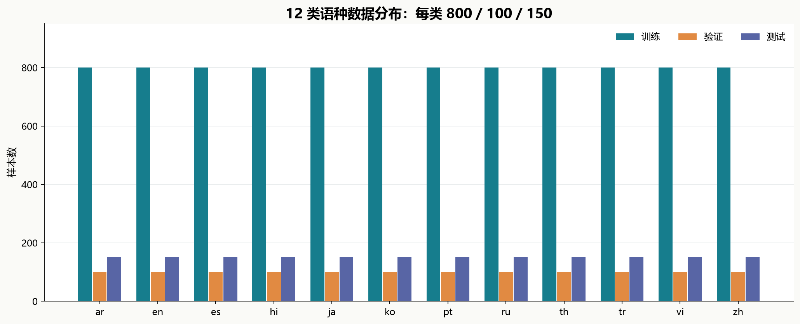
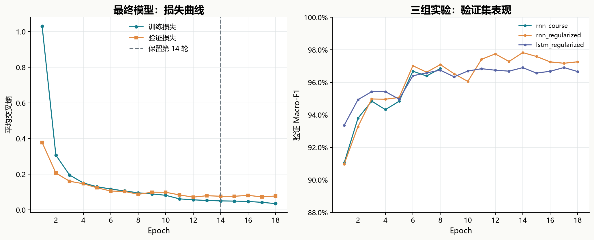
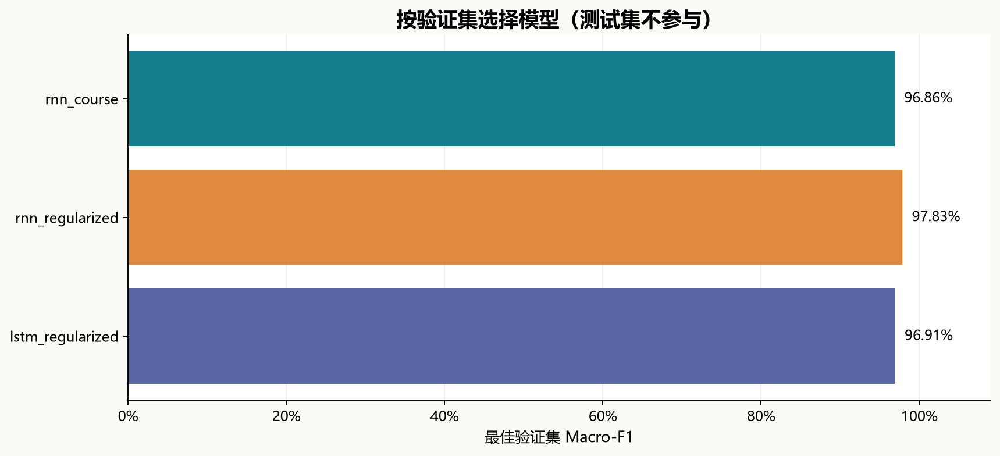
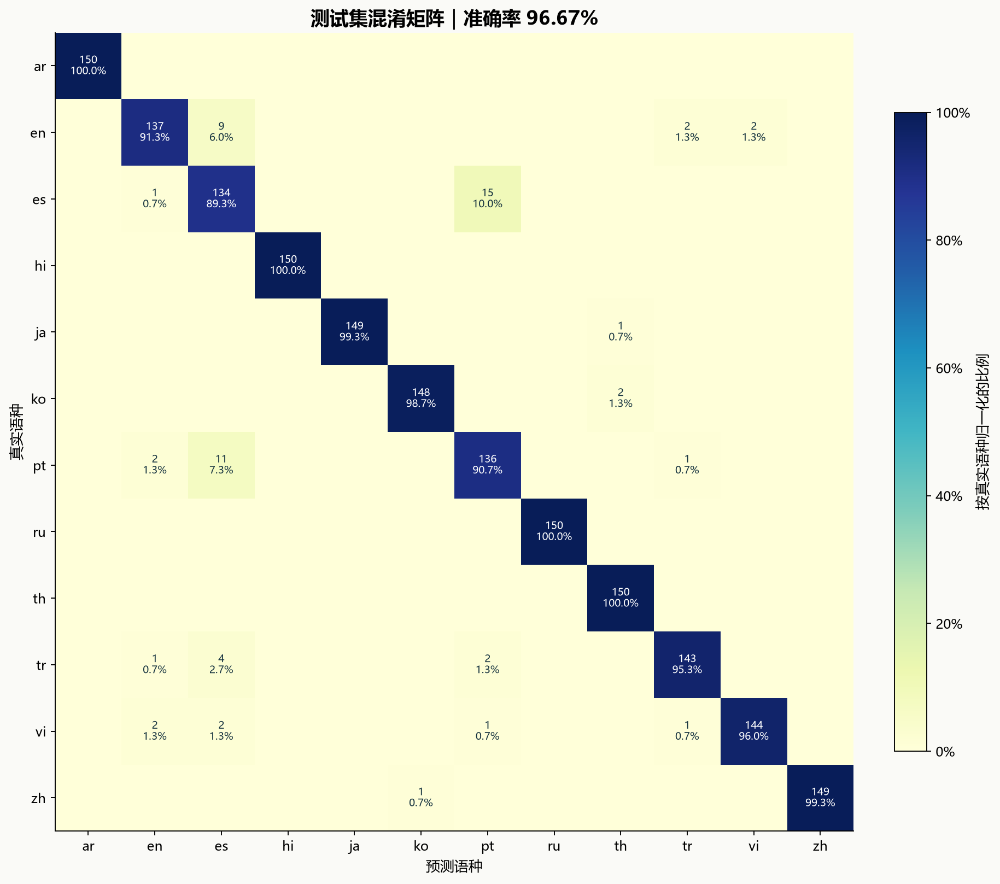
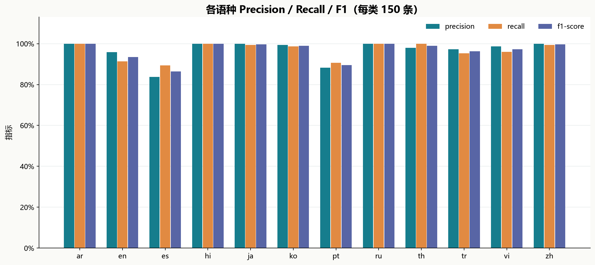
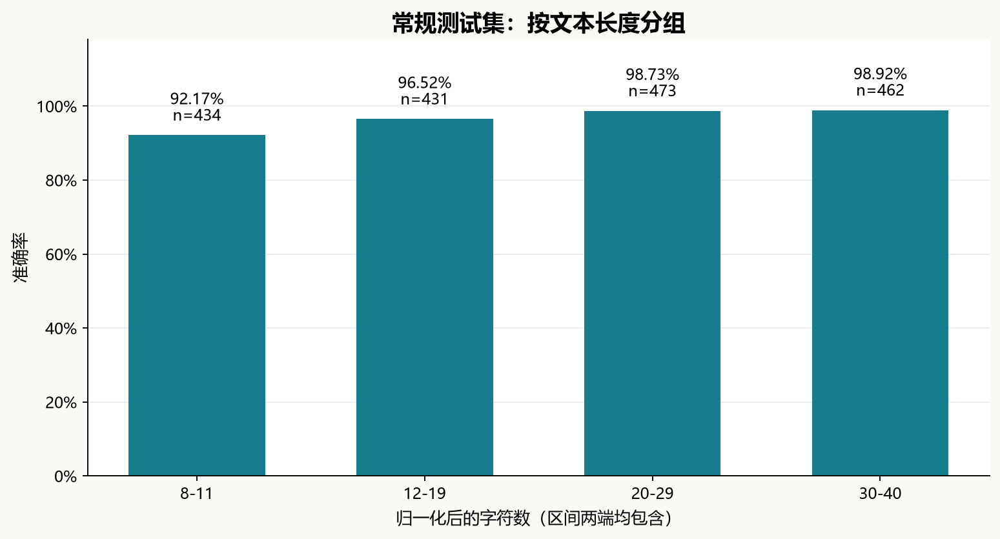
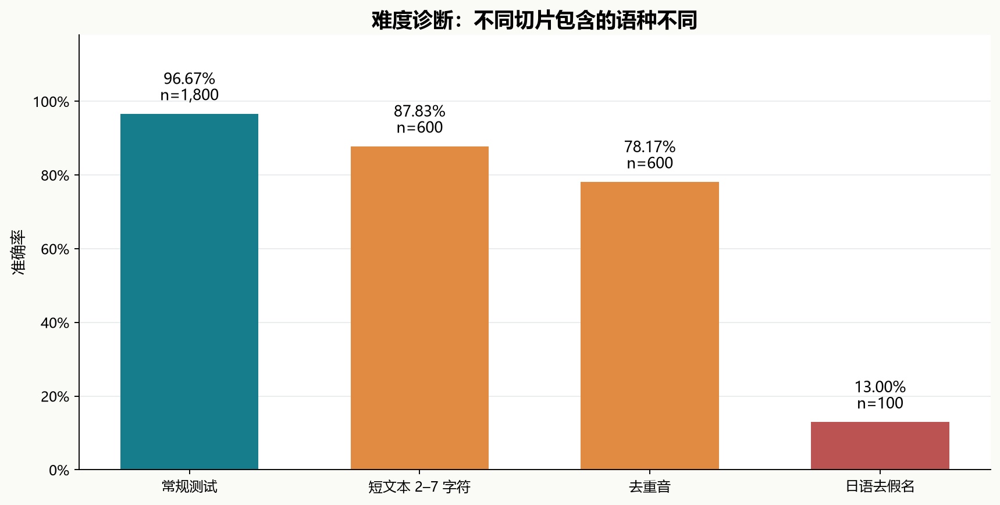
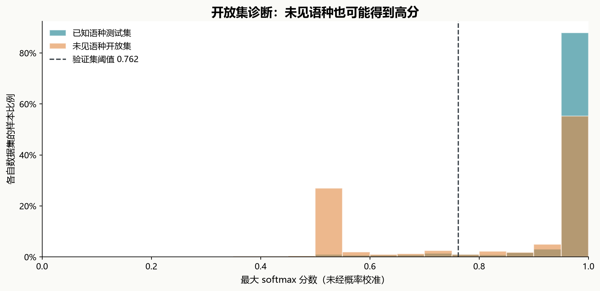

# 第三周作业：十二类语种分类模型训练

姓名：周树晖　｜　周次：week03

本项目将课程中的 8 类字符级语种识别模型扩展为 **12 类**，完成训练集字符表构建、三组模型训练、验证集选型、独立测试、错误分析和可视化。最终模型在 **1,800 条测试文本中正确分类 1,740 条，Accuracy 为 96.67%，Macro-F1 为 0.9670**。

## 一、数据集与划分

使用第三周课件“语种识别实战”提供的 `v12` 数据。根据随课[数据卡](data/langid/DATA_CARD.md)，原始句子来自 Tatoeba，采用 CC-BY 2.0 FR 许可；本目录保留数据卡及其来源、署名与许可链接。课堂训练代码备份在 [references/course_train_langid_cls.py](references/course_train_langid_cls.py)，用于对照阅读，不作为本项目运行依赖。

12 个类别为：阿拉伯语 ar、英语 en、西班牙语 es、印地语 hi、日语 ja、韩语 ko、葡萄牙语 pt、俄语 ru、泰语 th、土耳其语 tr、越南语 vi、中文 zh。相较课堂的 8 类，新增 ko/th/tr/vi。

| 划分 | 总样本数 | 每类样本数 | 归一化长度 |
| --- | ---: | ---: | --- |
| 训练集 | 9,600 | 800 | 8–40 |
| 验证集 | 1,200 | 100 | 8–40 |
| 测试集 | 1,800 | 150 | 8–40 |

沿用原始划分，无重新抽样。检查归一化文本后，划分内部重复数及 train/dev/test 两两交集均为 **0**；难度集与开放集也不与三个正式划分重合。检查的是文本重复，不能据此排除同义改写或翻译关系。统计与文件 SHA-256 保存在 [outputs/data_audit.json](outputs/data_audit.json)。



### 文本编码与字符表设计

CSV 的 `text` 保留原句；模型输入统一执行 `NFKC → 小写 → 保留 Unicode 字母 L 和组合符号 M`。必须保留 M，否则会丢失印地语、泰语等语言的组合标记。样本经过编码后截断至 40 字符，不足部分在右侧补齐。

字符表**只从 9,600 条训练文本生成**，按频次降序、同频按字符编码排序。实测有 **3,274 个普通字符，加入 `<PAD>=0` 和 `<UNK>=1` 后共 3,276 项**，已保存为 [vocab_v12.txt](data/langid/vocab/vocab_v12.txt) 与 [vocab.json](models/vocab.json)。训练集外字符映射为 UNK；验证集和测试集的字符级 UNK 比例分别为 0.45% 和 0.59%。未复用课堂的 v8 字符表。

## 二、模型结构与组件设计

最终采用单层、单向的字符级 RNN，输出维度由训练集的 12 个标签确定。

```text
原始文本
  → NFKC / 小写 / L+M 字符筛选
  → 字符 ID，形状 [B, 40]
  → Embedding(3276, 64, padding_idx=0)，形状 [B, 40, 64]
  → RNN(64, 64)，形状 [B, 40, 64]
  → 掩码 GlobalMaxPool，形状 [B, 64]
  → LayerNorm(64) → Dropout(0.3)
  → Linear(64, 12)，输出 logits [B, 12]
  → 推理时 Softmax / Argmax
```

Embedding 学习多种文字的向量表示；RNN 建模字符顺序及上下文；最大池化提取有效位置最强的特征。池化前将 PAD 位置置为极小值，避免补齐状态被当成特征。LayerNorm 稳定隐藏表示，Dropout 用于训练阶段正则化。训练直接将 logits 传入 `CrossEntropyLoss`，推理时才计算 Softmax。

模型参数量为 **218,892**，其中 Embedding 为 209,664，RNN 为 8,320，LayerNorm 为 128，分类层为 780。LSTM 对照只替换序列编码器，其他维度保持一致；源码见 [src/model.py](src/model.py)。

## 三、训练方法与模型选择

三组实验在训练前写入 [configs/experiments.json](configs/experiments.json)。统一随机种子 42，单线程 CPU，批大小 64，Adam 初始学习率 0.001，交叉熵损失。每轮打乱训练样本，验证时调用 `model.eval()` 并关闭梯度。设置确定性算法，记录环境和逐轮日志。

| 实验 | 主要设置 |
| --- | --- |
| `rnn_course` | 课堂结构扩展到 12 类；8 轮，Dropout 0.3，无权重衰减、无调度 |
| `rnn_regularized` | 同一 RNN；最多 18 轮，权重衰减 0.0001，学习率调度、早停 |
| `lstm_regularized` | 同一训练策略，将 RNN 替换成 LSTM |

调度器 `ReduceLROnPlateau` 监控验证 Macro-F1，连续 2 轮不提升后学习率减半（`patience=1`）。早停在连续 4 轮没有更优验证结果时触发。每组按验证 **Macro-F1 最高**保存模型；平分时选择验证交叉熵更低者。再按相同标准选出最终模型，先保存 [selection.json](outputs/selection.json)，随后评估测试集。**测试集未参与字符表构建、参数调整、轮次或模型选择。**

| 实验 | 编码器 | 实际轮数 / 保留轮次 | 验证 Accuracy | 验证 Macro-F1 | 训练秒数 |
| --- | --- | ---: | ---: | ---: | ---: |
| `rnn_course` | RNN | 8 / 8 | 96.83% | 0.9686 | 5.65 |
| `rnn_regularized` | RNN | 18 / 14 | 97.83% | 0.9783 | 12.59 |
| `lstm_regularized` | LSTM | 18 / 17 | 96.92% | 0.9691 | 23.77 |

选中 `rnn_regularized` 的第 **14** 轮；总计训练 18 轮，第 18 轮达到早停条件，最终使用保存的第 14 轮权重。本次 LSTM 没有超过正则化 RNN。RNN 两组同时改变训练预算、权重衰减和调度方式，因此这组对比不能单独证明某个组件的贡献，也没有多随机种子显著性结论。



训练损失来自开启 Dropout 的训练批次，验证损失来自关闭 Dropout 的独立验证集，因此验证损失可能低于训练损失。曲线右图纵轴范围为 88%–100%。



## 四、最终测试指标

以下是锁定的最终模型在原始 `v12/test.csv` 上的**闭集 12 分类**结果，未使用拒识阈值。

| 指标 | 结果 |
| --- | ---: |
| 测试样本 | 1,800 |
| 正确 / 错误 | 1,740 / 60 |
| Accuracy | **96.67%** |
| Macro-F1 | **0.9670** |
| Weighted-F1 | 0.9670 |
| 平均交叉熵 | 0.0875 |
| Accuracy 的 Wilson 95% 区间 | 95.73%–97.40% |
| 均匀随机猜测 Accuracy 期望 | 8.33% |
| Unicode 区段多数票 Accuracy | 66.00% |

Macro-F1 是 12 个语种 F1 的等权平均；各类支持数相同，所以此处与 Weighted-F1 相等。Wilson 区间只反映此测试样本下的二项抽样近似，不能衡量换域或训练随机性。区段规则采用课堂 demo 的思路，按文字区段计票，拉丁字母统一猜英语，无法区分同一书写系统的多个语种。



混淆矩阵纵轴为真实类别，横轴为预测类别；颜色是行归一化比例，格子显示样本数和比例，空白表示 0。

| 标签 | 语种 | 样本数 | Precision | Recall | F1 |
| --- | --- | ---: | ---: | ---: | ---: |
| ar | 阿拉伯语 | 150 | 1.0000 | 1.0000 | 1.0000 |
| en | 英语 | 150 | 0.9580 | 0.9133 | 0.9352 |
| es | 西班牙语 | 150 | 0.8375 | 0.8933 | 0.8645 |
| hi | 印地语 | 150 | 1.0000 | 1.0000 | 1.0000 |
| ja | 日语 | 150 | 1.0000 | 0.9933 | 0.9967 |
| ko | 韩语 | 150 | 0.9933 | 0.9867 | 0.9900 |
| pt | 葡萄牙语 | 150 | 0.8831 | 0.9067 | 0.8947 |
| ru | 俄语 | 150 | 1.0000 | 1.0000 | 1.0000 |
| th | 泰语 | 150 | 0.9804 | 1.0000 | 0.9901 |
| tr | 土耳其语 | 150 | 0.9728 | 0.9533 | 0.9630 |
| vi | 越南语 | 150 | 0.9863 | 0.9600 | 0.9730 |
| zh | 中文 | 150 | 1.0000 | 0.9933 | 0.9967 |



完整数值见 [final_metrics.json](outputs/evaluation/final_metrics.json)、[classification_report.csv](outputs/evaluation/classification_report.csv)。逐条预测、分数和全部 60 条错误见 [test_predictions.csv](outputs/evaluation/test_predictions.csv) 与 [errors.csv](outputs/evaluation/errors.csv)。

## 五、错误分析与难度诊断

主要混淆方向如下；西班牙语和葡萄牙语双向混淆共 26 条，占全部错误的 43.33%。共享拉丁字母的语言需要依靠字符组合和顺序区分。阿拉伯语、印地语、俄语在本测试集上召回率为 100%，这只说明当前样本的表现。

| 真实 → 预测 | 错误数 |
| --- | ---: |
| es → pt | 15 |
| pt → es | 11 |
| en → es | 9 |
| tr → es | 4 |
| en → tr | 2 |
| en → vi | 2 |



额外使用随课难度集 1,300 条做诊断，不参与训练或选型：

| 切片 | 含义及覆盖语种 | 样本数 | Accuracy | Macro-F1 |
| --- | --- | ---: | ---: | ---: |
| short | 2–7 字符；12 类 | 600 | 87.83% | 0.8785 |
| nodeaccent | 去掉重音符号；en/es/pt/tr/vi | 600 | 78.17% | 0.7723 |
| nokana | 去掉日语假名；仅 ja | 100 | 13.00% | 0.2301 |

切片 Macro-F1 只对该切片有真实样本的语种取平均；`nokana` 只有 ja，其 F1 是 ja 的类别 F1，不能作为 12 类总指标。三个切片的类别组成不同，彼此以及与常规测试集之间并非严格配对的消融对照。日语去假名后失去重要的文字特征，准确率仅 13.00%；短文本和去重音也更难判断。



### 开放集扩展：能力边界

使用 400 条从未训练过的语种文本（el/bg/sw/ur）测试简单阈值拒识。阈值仅由已知语种验证集最大 Softmax 分数的 5% 分位数确定，为 **0.7617**；低于阈值返回 unknown。

验证集已知语种保留率为 95.00%，独立测试已知语种保留率为 94.44%，开放集未知语种拒识率仅 **34.75%**。Softmax 分数未经概率校准，高分不能保证属于已知语种。

| 未知语种 | 数量 | 拒识率 | 未拒识样本被判为 |
| --- | ---: | ---: | --- |
| bg | 100 | 0.00% | ru: 100 |
| el | 100 | 100.00% | 全部拒识 |
| sw | 100 | 37.00% | en: 30, tr: 31, es: 2 |
| ur | 100 | 2.00% | ar: 98 |

保加利亚语与俄语共享西里尔字母，乌尔都语与阿拉伯语的书写系统相近，当前模型会高分误判。此扩展用于揭示局限，不能作为可靠的开放集识别系统；正式作业的 12 类闭集指标与它分别统计。



## 六、运行与复现

项目已包含所需 CSV、训练好的权重、日志和图表，无需重新下载语料。进入本 README 所在目录，用 PowerShell 执行：

```powershell
# 安装依赖（环境已有时可跳过）
python -m pip install -r requirements.txt

# 一键重跑：检查数据 → 生成字表 → 三组训练 → 选择模型 → 评测 → 图表和报告
python -X utf8 run_all.py

# 使用已保存模型预测
python -X utf8 predict.py --text "这是一个语种识别模型。" "This is a language classifier."

# 从 UTF-8 文件读取，每行一个样本
python -X utf8 predict.py --input-file demo_texts.txt

# 可选：启用验证集阈值拒识
python -X utf8 predict.py --reject-unknown --text "This is a sentence."

# 只重建报告；不训练、不修改权重
python -X utf8 run_all.py --report-only

# 核对词表、权重、全部测试预测和指标，测试掩码与输入边界
python -X utf8 verify_project.py
```

分步运行可使用 `python -m src.data`、`python -m src.train`、`python -m src.evaluate` 和 `python -m src.report`。复训会更新本目录的模型、日志与结果。推理保持训练时相同的归一化和 40 字符截断策略；空白、纯数字或纯标点输入会被明确拒绝。原数据中文已转简体，推理没有额外繁简转换；长文本、混排文本和课外领域表现需要另行验证。

本次环境：Python 3.14.4，PyTorch 2.12.0+cu130，NumPy 2.4.4，scikit-learn 1.9.0；训练使用 **cpu、1 线程**。三组训练累计约 42.00 秒（不含导入、数据检查、评测和制图）。实际版本与系统信息保存在 [logs/environment.json](logs/environment.json)；不同版本与设备可能产生小幅数值差异。

## 七、交付文件

```text
作业-十二类语种分类完整训练实践/
├── README.md                    本报告：设计、训练、指标、可视化和复现
├── run_all.py                   一键执行
├── predict.py                   单句或文件推理
├── verify_project.py            独立核对结果与关键边界
├── demo_texts.txt                12 个语种的手写演示输入
├── requirements.txt             运行依赖
├── configs/experiments.json     固定实验配置
├── src/                         数据、模型、训练、评估、报告源码
├── data/langid/                 v12 划分、难度集、开放集、数据卡、新字符表
├── models/                      三组最优权重、best_model.pt、词表和标签
├── outputs/                     数据审计、选型、逐轮历史、详细评测与核验记录
├── logs/                        环境、真实运行日志
├── images/                      8 张由结果生成的图表
└── references/                  课堂 8 类训练代码备份
```

## 八、实验结论

本次完成了从 8 类到 12 类的字符级语种分类训练：重新生成 3,276 项字符表，将输出层扩展为 12 类，通过验证集选定第 14 轮 RNN 模型，在独立测试集取得 **Accuracy 96.67%、Macro-F1 0.9670**。主要错误集中在拉丁字母语种之间；去假名和未知语种诊断说明，闭集高分仍不能保证模型在特征缺失或新语种上的可靠性。
