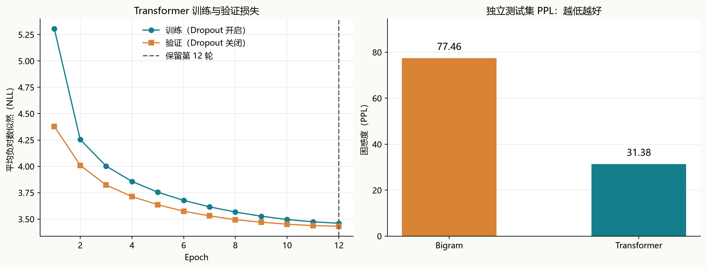

# 第四周作业：训练基于 Transformer 的语言模型

姓名：周树晖　｜　周次：week04

使用第四周随课中文语料，从随机初始化开始训练字符级自回归 Transformer，学习根据前文预测下一个字符。最终模型在独立测试集上的 **PPL 为 31.38，下一字符准确率为 37.96%**；同字表、同划分的 Bigram 基线 PPL 为 77.46。

## 一、课程内容与任务

课件讲解了 N-gram、RNN/LSTM、BERT，以及 Transformer 的位置编码、多头自注意力、前馈网络、残差连接和 LayerNorm。本作业沿用课程 `language_model.py` 的字符级下一步预测任务，将循环网络替换为 Transformer。

模型使用单向因果注意力，预测位置 t 的下一个字符时只能访问 0…t 的输入。BERT 的 MLM 使用双向上下文和随机掩码；本项目训练的是用于续写的自回归语言模型，未加载现成 BERT/GPT 权重，也未调用外部生成 API。

## 二、语料与数据设计

语料来自第四周文件夹中的 `循环神经网络语言模型/corpus_general.txt`，原文件复制为 [data/corpus.txt](data/corpus.txt)。按通用换行读取后共 6,021,645 个字符、395,286 行，内容主要是中文问题、口语及业务对话短句。

先逐行 NFKC 归一化、合并行内空白、去除首尾空白，再去掉空行和完全相同的句子。共去除 149,734 条重复记录，保留 **245,552 条唯一句子**。用随机种子 42 打乱，按 90% / 5% / 5% 划分。三个划分的完整归一化句子交集为 0；此检查不排除近似句或同义改写。

| 划分 | 句子数 | 编码字符数 | 计分目标数 | UNK 比例 |
| --- | ---: | ---: | ---: | ---: |
| 训练 | 220,996 | 3,709,092 | 3,709,091 | 0.068% |
| 验证 | 12,278 | 204,179 | 204,178 | 0.092% |
| 测试 | 12,278 | 204,816 | 204,815 | 0.074% |

字表只由训练集统计，包含 `4,000` 项：`<PAD>=0`、`<UNK>=1`，以及按频次选取的 3,998 个字符。保留标点、数字、空格和换行；低频字、训练外字符映射到 UNK，不直接删除原文中的字。训练集实际出现 5,230 种普通字符。

各划分分别用换行连接句子，并在首尾补一个换行，再按 128 个输入位置切成独立块。输入 `x=stream[s:s+128]`，目标 `y=stream[s+1:s+129]`，两者错开一位。每个目标字符只计分一次；末块补 PAD，其无效目标标记为 -100 并从交叉熵与准确率中排除。换行、UNK 都参与计分，PAD 不参与输出分布。块之间不传递隐藏状态，块内最多利用 128 字符上下文，也可能读到前一条句子。

分词结果保存在 [data/tokens.npz](data/tokens.npz)，字表在 [data/vocab.json](data/vocab.json)。[results/data_stats.json](results/data_stats.json) 记录处理规则、划分数量和原始语料 SHA-256，运行 `prepare_data.py` 可由原始文件重新构建。

## 三、模型设计

```text
输入字符 ID [B, T]，T ≤ 128
  → Token Embedding(4000, 192) + 可学习 Position Embedding(128, 192)
  → Dropout(0.1)
  → Transformer Block × 4
      ├─ x = x + CausalMultiHeadAttention(LayerNorm(x))
      └─ x = x + FFN(LayerNorm(x))
  → LayerNorm
  → 共享字符 Embedding 权重的输出层
  → logits [B, T, 4000]
```

| 参数 | 设置 |
| --- | ---: |
| Transformer 层数 | 4 |
| 隐藏维度 d_model | 192 |
| 注意力头数 / 单头维度 | 4 / 48 |
| FFN 中间维度 | 768 |
| 最大上下文 | 128 |
| Dropout | 0.1 |
| 总参数量（共享权重不重复计数） | **2,572,416** |

注意力计算为 `softmax(QKᵀ / sqrt(d_head) + causal_mask) V`，通过 PyTorch 的 `scaled_dot_product_attention(..., is_causal=True)` 实现，右侧未来位置被屏蔽。FFN 为 `192 → 768 → GELU → 192`；使用 Pre-LN 和残差连接稳定训练。模型定义见 [model.py](model.py)。

## 四、训练方法

训练目标是有效目标位置上的平均交叉熵。损失直接接收 logits，训练时不先做 Softmax；采样生成时才将最后一个位置的 logits 转为概率。

| 训练项 | 设置 |
| --- | --- |
| 优化器 | AdamW，betas=(0.9, 0.95) |
| 学习率 | 0.0006，预热 100 步后余弦衰减至 6e-05 |
| 权重衰减 | 0.01 |
| Batch size | 64，保留最后不足一批的数据 |
| 梯度裁剪 | L2 范数上限 1.0 |
| 随机种子 | 42 |
| 最大训练轮数 / 早停耐心 | 12 / 3 轮 |
| 选型依据 | 验证集 token NLL 最低 |
| 本次设备 / 精度 | NVIDIA GeForce RTX 5070 Laptop GPU / BF16 autocast |

实际训练 12 轮，保存第 **12** 轮；本次未触发早停。训练耗时约 **85.2 秒**，不含导入、数据处理和最终评测。初始随机模型验证 PPL 为 4157.72，训练后降到 30.93。训练预算内验证损失持续改善，不据此声称已经达到最优训练规模。

配置见 [config.json](config.json)，逐轮记录见 [results/history.json](results/history.json)，环境、权重哈希及选型信息见 [results/training.json](results/training.json)。字表、权重和训练轮次均未使用测试集选择。



左图训练损失在开启 Dropout、参数不断更新时统计，验证损失在关闭 Dropout 的固定模型上统计，因此验证损失可以低于训练损失。右图仅比较已锁定模型的独立测试结果。

## 五、最终评估

`NLL = -Σ log P(y_t | x_≤t) / N`，`PPL = exp(NLL)`，N 为有效目标字符数。先累加所有目标的损失，再除以总字符数，不直接平均各批次 PPL。准确率是下一字符 Top-1 命中率。

| 划分 | NLL | PPL ↓ | 下一字符准确率 ↑ |
| --- | ---: | ---: | ---: |
| 训练（评估模式） | 3.2718 | 26.36 | 39.20% |
| 验证 | 3.4316 | 30.93 | 38.12% |
| 测试 | 3.4462 | 31.38 | 37.96% |

训练集这一行是选中权重在关闭 Dropout 后重新评估的结果，与训练过程中记录的在线训练损失含义不同。测试集共计分 **204,815** 个目标字符，命中 77,742 个。

| 测试模型 | PPL ↓ | 下一字符准确率 ↑ |
| --- | ---: | ---: |
| 均匀分布（不含 PAD 的 3999 项） | 3999.00 | — |
| Unigram + 加性平滑 | 589.72 | 5.99% |
| Bigram + 加性平滑 | 77.46 | 23.92% |
| Transformer | **31.38** | **37.96%** |

统计基线只从训练集计数，平滑系数固定为 0.1，采用完全相同的字表、划分、UNK 和换行计分规则。Transformer 测试 PPL 比 Bigram 低 **59.49%**。没有直接沿用课件中的 RNN/LSTM 指标，因为本项目重新去重、划分并保留 UNK，评测条件不同。

详细评测见 [results/metrics.json](results/metrics.json)。PPL 衡量对真实目标字符分配的概率，并不是“从 PPL 个字里猜一个”的严格计数。字符级 PPL 不能直接与采用其他字表或分词器的模型比较。

## 六、文本生成结果与局限

以下使用同一个保存模型，提示固定，`temperature=0.8`、`top_k=40`、随机种子 42，最多生成 60 个新字符，遇到换行停止。全部六个提示的结果如下，未根据好坏筛选。

| 输入提示 | 实际续写 |
| --- | --- |
| 今天天气 | 怎么样 |
| 我想学习 | 英语单词。 |
| 人工智能 | 手机号码怎么设置 |
| 请问 | 您的姓名和您可以电脑端操作绑定支付宝账户,是否可以的 |
| 我们可以 | 给我找回来吧 |
| 中国的 | 中国梦想是什么意思 |

同样以“我想学习”为提示，贪心解码（temperature=0）得到：**我想学习英语**。完整生成配置和结果保存在 [results/generations.json](results/generations.json)。生成时屏蔽 PAD/UNK；正式 PPL 评估仍把真实 UNK 纳入计分，未使用 Top-k 或温度修改评估分布。

模型已能生成部分常见问句及短语，但也出现搭配不合理、重复和主体不清的文本，例如“人工智能手机号码怎么设置”。这与短句语料、约 257 万参数及有限训练预算有关。它没有指令微调或事实核查能力；测试分数反映同分布字符预测，不代表开放域问答质量。上下文窗口为 128 字符，续写时滑动截取最近窗口，无法保留更早的完整历史。

## 七、运行方式

进入本 README 所在目录后执行：

```powershell
python -m pip install -r requirements.txt

# 从零完成数据处理、训练、评估和 README 更新
python -B -X utf8 run_all.py

# 直接用现有权重续写；不重新训练
python -B -X utf8 generate.py --prompt "我想学习" --max-new-tokens 60
python -B -X utf8 generate.py --prompt "今天天气" --temperature 0

# 独立运行关键正确性测试
python -B -X utf8 test_model.py

# 使用现有权重重新评估并更新 README
python -B -X utf8 run_all.py --evaluate-only
```

`device=auto` 优先使用 CUDA，无 GPU 时使用 CPU；也可在 `config.json` 中指定 `cpu`。CPU 或不同 GPU 的数值可能与本次 BF16 结果略有差异。重新训练会覆盖本目录的模型和结果。

本次环境：Python 3.14.4，PyTorch 2.12.0+cu130，NumPy 2.4.4。测试覆盖因果掩码、前缀与补齐不变性、输入目标错位、尾块目标完整性、有限梯度、权重共享、去重划分及上下文越界处理。

## 八、文件说明

| 文件或目录 | 用途 |
| --- | --- |
| `README.md` | 课程对应、数据与模型设计、训练方法、指标、曲线和生成结果 |
| `config.json`、`requirements.txt` | 实验配置与依赖 |
| `prepare_data.py`、`model.py`、`train.py` | 数据处理、模型与训练 |
| `evaluate.py`、`generate.py` | 独立评估与续写 |
| `common.py`、`run_all.py`、`build_readme.py` | 公共读写、一键运行和报告更新 |
| `test_model.py` | 模型和数据边界测试 |
| `data/` | 课程原始语料、可复现的编码数据和字表 |
| `models/best_model.pt` | 最低验证 NLL 对应的权重及模型配置 |
| `results/` | 数据统计、逐轮历史、最终指标、实际续写和 README 引用的曲线 |
