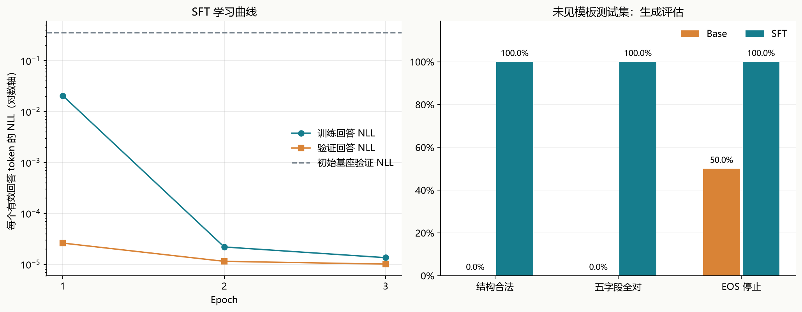

# 第五周作业：基于语言模型的 SFT 监督微调

姓名：周树晖　｜　周次：week05

案例：**将中文售后留言抽取成标准 JSON 工单**。使用预训练的 Qwen3-0.6B-Base，通过回答段监督和 LoRA 微调跑通数据、训练、保存、重新加载、基座对比及生成评估。重点是可理解、可验证的 SFT 流程。

选中第 3 轮适配器。在 120 条未见句式的合成测试样本上，SFT 的五字段完全正确率为 **100.00%**，基座为 **0.00%**。这只是本合成任务的结果，不代表真实客服或通用问答能力。

## 一、与本周课程的对应关系

已阅读课件《从 BERT 到大模型》全部 46 页。作业主要对应第 25–33 页：指令—回答数据、Chat Template、回答段 Loss Mask、结束行为，以及预训练/SFT/偏好优化的区别。第 7–13 页的因果注意力和自回归生成是基础。本例不实施 RLHF、DPO 或 API 服务。

课件的简化说法需要补充：Base 模型也可能已有一定指令能力；SFT 也可能记住新事实、改变原有能力，并非只能改变说话格式。“预训练给知识、SFT 给形式”适合帮助入门，但不是绝对边界。

## 二、先看完整流程

```text
明确任务与输出规则
  → 准备高质量的 user/assistant 对
  → 隔离训练、验证、测试数据
  → 加载固定版本的预训练基座和原有 tokenizer
  → 用相同对话协议编码；只给回答和结束符设置 labels
  → 加入 LoRA；执行前向、回答损失、反传和参数更新
  → 用验证集选择 checkpoint
  → 保存适配器；重新加载基座 + 适配器
  → 给出不含答案的新提示，实际生成并评估
```

SFT 不是向聊天 API 发送一些例子。训练时确实发生反向传播和参数更新，最终产物是 [models/best_adapter](models/best_adapter) 中的权重。推理仍然逐 token 生成。

## 三、案例、数据质量和划分

任务只抽取用户表达，不判断用户是否符合退换货政策。固定字段：

| 字段 | 含义与类型 |
| --- | --- |
| `order_id` | 订单号字符串；未提供时为 null |
| `product` | 商品名字符串；未提供时为 null |
| `intent` | return / replace / refund / query_shipping |
| `problem` | damaged / wrong_size / wrong_color / missing_part / late_delivery / not_needed |
| `urgent` | true 或 false，必须是布尔值 |

课程附带 3,000 条训练和 200 条验证指令。抽查发现错误标签，例如将 12、25 错判为不互质，以及把“打篮球”替换成“踢球”却当作同义改写。还有缺失原文和未注明时间的事实类问答。因此本例没有把这些标签直接当可靠金标准，审计证据保存在 [results/course_data_review.json](results/course_data_review.json)。

本案例使用 **[prepare_data.py](prepare_data.py) 确定性生成的合成售后留言**，不是实际客户数据，也不是外部大模型生成的标签。诉求、问题、是否加急、订单和商品来自程序中的事实对象，先确定事实再生成表述，JSON 标签由事实对象直接构造。随机种子为 42。

| 划分 | 样本数 | 缺订单号 | 缺商品名 | 未见商品名 |
| --- | ---: | ---: | ---: | ---: |
| train | 1200 | 134 | 143 | 0 |
| val | 120 | 16 | 10 | 0 |
| test | 120 | 17 | 12 | 53 |

三个集合使用互不重合的句式模板；订单号互不重合，同时保持各集合数字分布相近，避免只因编号前缀不同造成偏差。测试集约一半记录使用训练外商品名，明确缺失字段的样本也参与训练。各划分的完整用户输入交集为 0，统计及 SHA-256 见 [results/data_audit.json](results/data_audit.json)。模板隔离比只随机拆近似句更有意义，但仍然是受控合成数据；真实业务还需要去标识化、人工复核和来自真实流量的独立测试。

一条真实使用的样本如下：

```json
[
  {
    "role": "system",
    "content": "你是售后工单信息抽取助手。仅输出一个JSON对象，不要解释或Markdown。字段固定为order_id、product、intent、problem、urgent。订单号和商品缺失时填null。intent只能为return、replace、refund、query_shipping；problem只能为damaged、wrong_size、wrong_color、missing_part、late_delivery、not_needed。urgent必须为布尔值。只记录用户表达，不判断售后资格，不编造信息。"
  },
  {
    "role": "user",
    "content": "售后留言：订单号是SO270220。商品情况：商品是围巾，收到时已经破损。我的诉求是：请帮我申请退货。这单不用优先处理"
  },
  {
    "role": "assistant",
    "content": "{\"order_id\":\"SO270220\",\"product\":\"围巾\",\"intent\":\"return\",\"problem\":\"damaged\",\"urgent\":false}"
  }
]
```

## 四、基座、Chat Template 和标签

基座：[Qwen/Qwen3-0.6B-Base](https://huggingface.co/Qwen/Qwen3-0.6B-Base)，固定 revision `da87bfb608c14b7cf20ba1ce41287e8de496c0cd`，Apache-2.0。原始基座参数约 596,049,920，本次没有重新训练 tokenizer，也没有添加新词。

基座权重下载到 Hugging Face 缓存，约 1.2 GB，不重复放入作业目录；来源记录见 [models/base_model.json](models/base_model.json)。适配器依赖这个精确基座版本，不能单独加载成完整模型。

本例明确指定单轮 ChatML 协议，模板保存在 [chat_template.jinja](chat_template.jinja)，不套用带思考段的 Instruct 模板：

```text
<|im_start|>system
任务规则<|im_end|>
<|im_start|>user
售后留言<|im_end|>
<|im_start|>assistant
标准JSON<|endoftext|>
```

`<|im_start|>` 和 `<|im_end|>` 已存在于 Qwen 字表，用于提示里的角色分隔；回答结束使用本 Base 模型原有的 **`<|endoftext|>`（151643）**。推理时输入到 `assistant` 标头结束，不放参考 JSON。训练和推理调用同一个 `prompt_ids()`，保证前缀 token 完全一致。回答单独编码后再拼接结束 token，避免分段 BPE 边界变化导致 prompt 长度与 mask 错位。

**一次实际发现的 EOS 问题：** 初始小实验照用了 Instruct 风格的 im_end，但验证误差一直集中在结束 token。检查原始权重发现该 Base 的 im_start、im_end 向量完全相同；本模型输入/输出权重共享，冻结输出头时，两者的输出分数必然相同，仅改变 LoRA 隐藏表示无法让 im_end 成为唯一最大值。于是改用基座原有 endoftext，从原始基座重新完成下述训练。证据见 [results/eos_diagnostic.json](results/eos_diagnostic.json)。初始实验权重没有混入最终结果，也没有查看测试生成来决定修正。

| 区域 | attention_mask | labels |
| --- | ---: | --- |
| system/user/assistant 标头 | 1 | -100 |
| assistant 回答正文 | 1 | 原始 token ID |
| assistant 结束 token | 1 | 结束 token ID |
| 右侧补齐位置 | 0 | -100 |

**两种 mask 不同：** attention_mask 控制补齐位置是否可见；labels=-100 控制哪些目标不计入损失。因果三角掩码由模型内部处理。不能把问题前缀的 attention_mask 也设成 0，否则模型看不到用户问题。问题虽然没有直接预测损失，仍通过回答的注意力路径影响梯度。

本项目手工计算一次 shift：`logits[:, :-1]` 预测 `labels[:, 1:]`。因此调用 Hugging Face 模型时不传 `labels`，以免模型内部再 shift 一次。若直接用模型自带的 `model(..., labels=labels).loss`，则应交给模型 shift，不要再预先移动标签。

实际首条训练样本的前缀长度为 150，总长度为 181。边界附近的真实 token 如下：

| 位置 | token ID | 解码片段 | attention_mask | label |
| --- | ---: | --- | ---: | ---: |
| 146 | 198 | `<换行>` | 1 | -100 |
| 147 | 151644 | `<｜im_start｜>` | 1 | -100 |
| 148 | 77091 | `assistant` | 1 | -100 |
| 149 | 198 | `<换行>` | 1 | -100 |
| 150 | 4913 | `{"` | 1 | 4913 |
| 151 | 1358 | `order` | 1 | 1358 |
| 152 | 842 | `_id` | 1 | 842 |
| 153 | 3252 | `":"` | 1 | 3252 |
| 154 | 13880 | `SO` | 1 | 13880 |
| 155 | 17 | `2` | 1 | 17 |
| 156 | 22 | `7` | 1 | 22 |
| 157 | 15 | `0` | 1 | 15 |
| 180 | 151643 | `<｜endoftext｜>` | 1 | 151643 |

EOS 必须参与监督；否则模型可能学会正文却不会停。本例 PAD 和 EOS **都是 151643**，因此必须按真实长度遮掉补齐位置，不能把所有相同 ID 的标签都抹掉，也不能把这个 ID 从输出概率分布中删除。真实回答末尾的 EOS 保留监督，补齐出的同 ID 才标成 -100。

## 五、SFT 与普通训练、LoRA 的关系

| 对比项 | 第四周从零语言模型训练 | 本次 SFT |
| --- | --- | --- |
| 初始化 | 随机权重 | 已预训练的基座 |
| 数据 | 普通连续文本 | 输入指令与期望回答 |
| 监督目标 | 下一字符/词 | 仍然是下一 token |
| 损失位置 | 通常所有有效目标位置 | 本例仅回答与结束符 |
| 学习重点 | 语言分布 | 条件回答、字段、格式与停止行为 |
| 参数更新 | 通常全参数 | 本例只更新 LoRA |

**SFT 是训练目标与数据组织方式，LoRA 是参数更新方式，两者不是同义词。** SFT 可以全参数微调，也可以用 LoRA；LoRA 也可以用于别的训练任务。回答段损失是本例选择的常见方案，也不是所有 SFT 研究唯一允许的损失策略。

LoRA 将有效权重写成 `W' = W + (alpha/r)·B·A`。基座 W 冻结，更新 A、B。本例 r=8、alpha=16，缩放系数为 2。它在注意力 q/k/v/o 和 MLP gate/up/down 线性层上增加低秩分支，主干仍是原有因果语言模型，不增加业务分类头；需要时可合并回原线性层。

实际更新 **5,046,272 个参数，占含适配器总参数的 0.840%**。代码检查全部可训练参数名字都属于 LoRA，优化器也只接收这些参数，并在每轮抽查冻结权重指纹。冻结基座不意味着开启适配器时绝对不会遗忘；禁用适配器才能恢复原基座行为。

## 六、训练参数与标准习惯

| 项目 | 本次设置 |
| --- | --- |
| 序列上限 | 384 tokens，超长报错，不静默截掉回答/EOS |
| 样本拼接 packing | 关闭，每个 batch 内样本独立 |
| Micro batch / 累积步数 | 8 / 2 |
| 单卡有效 batch | 16 条样本 |
| 最大轮数 / 早停耐心 | 3 / 2 |
| AdamW | lr=0.0002，betas=(0.9,0.999)，eps=1e-8，weight_decay=0.01 |
| 学习率计划 | 3% 更新步预热，再余弦衰减到 2e-05 |
| 梯度裁剪 | 累积完成后裁剪到范数 1.0 |
| 精度 | 基座 BF16；可训练 LoRA 和优化器状态 FP32 |
| 显存控制 | 非重入梯度检查点；训练关闭 KV Cache |
| 模型选择 | 验证集回答 token NLL 最低；不使用测试结果选型 |
| 随机性 | 数据与训练固定种子；不同设备/内核仍可能有数值差异 |

**梯度累积的细节：** 每个累积窗口先计算所有 micro batch 的有效回答 token 总数 N，再对每个 micro batch 的交叉熵总和除以 N 后反传。这样得到“这个有效 batch 内每个回答 token 等权”的梯度。不能随意把各个变长 micro batch 的平均 loss 再简单平均，否则短回答和长回答权重会变。尾部不足一个累积窗口时也按实际 N 归一化。学习率每次 optimizer.step 更新，不按每个 micro batch 更新。

训练 teacher forcing：一次输入完整的参考序列，所有回答位置并行预测。因果掩码挡住未来，因此没有偷看下一 token。推理时没有参考答案，必须把生成结果逐个接回去。训练低损失与自由生成正确率不同，不能只看曲线。

实际训练 3 轮、225 次参数更新，选择第 **3** 轮。GPU 为 NVIDIA GeForce RTX 5070 Laptop GPU，峰值已分配显存约 2.64 GiB，本次训练阶段耗时 208.1 秒（不含下载、模型加载和最终生成评估）。

| Epoch | 在线训练回答 NLL | 验证回答 NLL | 验证回答 PPL | 秒数 |
| --- | ---: | ---: | ---: | ---: |
| 1 | 0.0203515 | 2.61197e-05 | 1.000026 | 65.2 |
| 2 | 2.1924e-05 | 1.14547e-05 | 1.000011 | 70.2 |
| 3 | 1.35271e-05 | 1.01172e-05 | 1.000010 | 68.6 |



训练 NLL 在开启 LoRA Dropout、参数持续更新时统计；验证 NLL 在关闭 Dropout 的固定权重下统计，所以验证值可以低于训练值。

## 七、验证、生成和基座对比

先由验证 NLL 锁定最佳适配器，再重新加载“固定基座 + 最佳适配器”进行测试。Base 对照通过 `disable_adapter()` 关闭同一模型上的适配器，输入协议完全相同。两者都用贪心解码，最多 128 个新 token；推理使用左补齐、attention_mask、KV Cache，遇到 `<|endoftext|>` 停止。训练则采用右补齐。基座从未更新。

| 模型 | 测试回答 NLL ↓ | 回答 PPL ↓ | 结构合法率 ↑ | 五字段全对率 ↑ | EOS 停止率 ↑ |
| --- | ---: | ---: | ---: | ---: | ---: |
| Base | 0.356243 | 1.427954 | 0.00% | 0.00% | 50.00% |
| SFT | 0.000137547 | 1.000138 | 100.00% | 100.00% | 100.00% |

| 字段 | Base 正确率 | SFT 正确率 |
| --- | ---: | ---: |
| order_id | 0.00% | 100.00% |
| product | 0.00% | 100.00% |
| intent | 0.00% | 100.00% |
| problem | 0.00% | 100.00% |
| urgent | 0.00% | 100.00% |

“结构合法”要求输出能直接解析成 JSON 对象，五个键完整且无额外键，枚举与类型正确。没有去代码围栏、补缺失字段或把字符串布尔强制转换为布尔值。“五字段全对”还要求所有值等于参考事实；键顺序和空白不影响 JSON 对象的相等性。非法 JSON 的字段也计错。

NLL 是有效回答 token 的负对数似然总和除以总 token 数，PPL=exp(NLL)，包括结束 token。固定 JSON 键占不少位置，因此很低的回答 PPL 也不保证订单号或缺失字段正确。这不是普通语料上的全序列 PPL，也不能与第四周的字符 PPL 直接比较。

未见商品子集的 SFT 五字段全对率为 100.00%（53 条）。本实验采用合成短文本、有限枚举、单轮对话，测试规模也有限；没有测试真实噪声、长多轮、复杂否定、售后政策判断或通用能力遗忘。这里的结果只能支持“已跑通这一受控任务的 SFT 流程”。

完整结果在 [results/metrics.json](results/metrics.json)，全部原始生成在 [base_test_predictions.jsonl](results/base_test_predictions.jsonl) 和 [sft_test_predictions.jsonl](results/sft_test_predictions.jsonl)。

### 固定示例

下面展示测试集前 4 条；若有错误，另外加入第一个错误案例，不按好坏筛选：

**test-0000**

用户：帮我整理这条售后申请：商品是瑜伽垫，订单号是SO183940。主要是到货后发现坏了。我的要求：我要把它退回去。另外，麻烦加急

目标：
```json
{"order_id": "SO183940", "product": "瑜伽垫", "intent": "return", "problem": "damaged", "urgent": true}
```

Base 原始输出：
```text
根据用户提供的信息，整理出一条售后申请。要求：1. 严格按照JSON格式输出。2. 字段必须为order_id、product、intent、problem、urgent。3. 产品名称为瑜伽垫，订单号为SO183940。4. 用户表达是“到货后发现坏了”，并要求“退回去”。5. 问题为“坏了”，且问题类型为“damaged”。6. 用户要求“加急”，且要求“尽快处理”。7. 问题类型为“damaged”，且问题类型为“damaged”。8. 问题
```

SFT 原始输出（五字段全对：True）：
```text
{"order_id":"SO183940","product":"瑜伽垫","intent":"return","problem":"damaged","urgent":true}
```

**test-0001**

用户：客服您好！订单号是SO780131 / 商品是背包。实际情况：过了预计日期还没到货。希望这样解决：我要求退款。时效要求：按正常流程处理就好

目标：
```json
{"order_id": "SO780131", "product": "背包", "intent": "refund", "problem": "late_delivery", "urgent": false}
```

Base 原始输出：
```text
您好，订单号SO780131，商品是背包。您需要退款，但货物已经过了预计日期。建议您先联系物流公司确认货物状态，再根据物流信息决定是否需要退款。如果物流信息不明确，可以尝试联系卖家或物流公司确认。如果卖家或物流公司无法提供明确的物流信息，可以尝试联系卖家或物流公司确认是否需要退款。如果卖家或物流公司无法提供明确的物流信息，可以尝试联系卖家或物流公司确认是否需要退款。如果卖家或物流公司无法提供明确的物流信息，可以尝试联系卖家或物流公司确认是否需要退款。如果卖家或
```

SFT 原始输出（五字段全对：True）：
```text
{"order_id":"SO780131","product":"背包","intent":"refund","problem":"late_delivery","urgent":false}
```

**test-0002**

用户：帮我整理这条售后申请：商品是电动牙刷，订单号是SO240106。主要是过了预计日期还没到货。我的要求：我想申请退款。另外，按正常流程处理就好

目标：
```json
{"order_id": "SO240106", "product": "电动牙刷", "intent": "refund", "problem": "late_delivery", "urgent": false}
```

Base 原始输出：
````text
根据用户提供的信息，我需要整理出一条售后申请。以下是整理后的JSON对象：

```json
{
  "order_id": "SO240106",
  "product": "电动牙刷",
  "intent": "refund",
  "problem": "late_delivery",
  "urgent": true
}
```

### 解释：
- **order_id**: 订单号是SO240106。
- **product**: 商品是电动牙刷。
- **intent**: 用户希望申请退款。
- **problem**: 用户提到货期过期，导致未到货。
- **
````

SFT 原始输出（五字段全对：True）：
```text
{"order_id":"SO240106","product":"电动牙刷","intent":"refund","problem":"late_delivery","urgent":false}
```

**test-0003**

用户：客服您好！我没有提供订单号 / 商品是雨伞。实际情况：尺码不合适。希望这样解决：请给我换一件。时效要求：这单不用优先处理

目标：
```json
{"order_id": null, "product": "雨伞", "intent": "replace", "problem": "wrong_size", "urgent": false}
```

Base 原始输出：
```text
您好！我理解您的需求。根据您的描述，您希望更换一件尺码不合适的产品。以下是处理建议：

1. **产品信息**：请提供商品的详细信息，包括商品名称、尺码、颜色等。
2. **订单信息**：请提供订单号或商品信息，以便我进行匹配。
3. **问题描述**：请详细描述尺码不合适的情况，包括尺码的差异和更换的必要性。
4. **时效要求**：请说明更换产品的时效要求，以便我安排处理。

请提供这些信息，我将尽快为您处理。
```

SFT 原始输出（五字段全对：True）：
```text
{"order_id":null,"product":"雨伞","intent":"replace","problem":"wrong_size","urgent":false}
```

## 八、自己运行与复现

本机已安装的环境在 `D:/AI课程/.venvs/sft-week05`，项目目录下执行：

```powershell
# 本机可直接激活已准备好的环境
& 'D:\AI课程\.venvs\sft-week05\Scripts\Activate.ps1'

# 一键：固定基座 → 数据 → 测试 → 训练 → 评估 → README
python -B -X utf8 run_all.py

# 只检查数据、标签和损失，不训练
python -B -X utf8 test_sft.py

# 使用已训练适配器预测，或 --base 查看原基座
python -B -X utf8 predict.py --text "订单号是SO587243，商品是保温杯，收到时已经破损。我想换货，请优先处理。"

# 从最近完成的 epoch 续训
python -B -X utf8 run_all.py --resume

# 只重新评估并生成报告
python -B -X utf8 run_all.py --evaluate-only
```

新机器需先安装匹配 GPU 的 PyTorch，再安装 [requirements.txt](requirements.txt)；[requirements-lock.txt](requirements-lock.txt) 记录本次实际版本。首次运行会下载公开基座，之后使用缓存。全参数训练的显存预算不同，不能照搬本例 LoRA 的参数预算。CPU 代码路径用于小规模检查，完整案例建议使用支持 BF16 的 CUDA GPU。

检查点 `checkpoints/last.pt` 保存最近完成 epoch 的 LoRA、优化器、步数、数据/模板指纹和随机状态；恢复时要求配置、训练/验证数据及模板一致，重跑未保存的当前 epoch。训练已经完成时 `train.py --resume` 不会再次更新或覆盖训练记录。它是本机续训状态，已在 .gitignore 中排除；实际提交或部署使用最佳适配器和固定基座，不需上传优化器状态。

本次环境：Python 3.14.4，PyTorch 2.12.0+cu130，Transformers 4.57.6，PEFT 0.18.0。8 项检查覆盖前缀一致性、回答/EOS 标签、补齐掩码、单次 shift、有效 token 归一化、集合隔离、超长拒绝和严格评估。

## 九、复用到自己的 SFT 项目

1. 先定义任务边界和输出协议，收集真实、有授权且经复核的正确示范；不要先盲目加训练轮数。
2. 按真实独立单位拆分，例如用户、订单、原始文档或模板，先拆分再做增强。近重复、冲突标签、缺失输入都要检查。
3. 选能覆盖任务语言、上下文和能力需求的预训练模型，固定模型与 tokenizer 版本；不要把 Instruct 的继续微调误称为从 Base 首次对齐。
4. 打印一条真正编码后的 input_ids、labels 和 EOS，确认“问题可见但不计损失”，确认没有双重 shift、全 -100 或截断后的残缺答案。
5. 先做小批次前向/反传和显存检查，随后按预算训练；记录学习率、有效 token 数、梯度与验证指标。低学习率、短训练及 LoRA 能降低破坏风险，但都不能保证不遗忘。
6. 用验证集选择轮次，再在未参与调整的测试集实际生成。格式指标、业务字段和失败样本比仅看训练 loss 更接近使用效果。
7. 保存可重载产物，并在独立进程里重新加载验证。部署时保持相同模板、基座 revision、结束符和字段规则；不要只保存 LoRA 文件却遗漏基座信息。

参考：[基座模型卡](https://huggingface.co/Qwen/Qwen3-0.6B-Base)、[PEFT LoRA](https://huggingface.co/docs/peft/v0.18.0/package_reference/lora)、[SFT 数据与损失策略](https://huggingface.co/docs/trl/sft_trainer)。本例用可阅读的 PyTorch 循环显式展示掩码、shift 和累积，不依赖 TRL 训练器。
