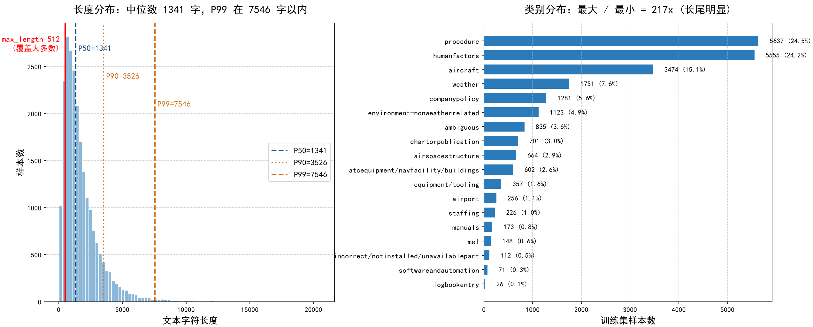

# 任务描述：
航空运维工单处理系统-根据描述给故障分类。
数据来源于sookiemonster/asrs-narratives-rebalance 标准训练数据，数据分布规律如下图所示

训练数据样例如下：
DatasetDict({
    train: Dataset({
        features: ['acn', 'text', 'label'],
        num_rows: 22992
    })
    validation: Dataset({
        features: ['acn', 'text', 'label'],
        num_rows: 4441
    })
    test: Dataset({
        features: ['acn', 'text', 'label'],
        num_rows: 9868
    })
})
{'acn': 2008766, 'text': "Narrative 1 - 'I was working ZZZ and North arrival. I had been on position for about 20 minutes and there was weather on the scope when I sat down. I was briefed that there had been some deviations but just light chop. And area of heavy precipitation which had been west of ZZZ1 eventually moved onto the final but aircraft were still taking the approach and landing. Eventually we got some LLWS alerts which I issued which in short time were followed by several go arounds and a microburst alert which I also issued as well as described the precipitation along the final. Aircraft X said he needed to discontinue the approach so I issued a 220 heading and 5000 feet since departure was getting a go-around in front of him and I couldn't turn him left or right due to airspace constraints. I yelled to departure and shipped him. In the mean time every other aircraft on final clogged up the frequency saying they also wouldn't take the approach. At some point Aircraft X said that he encountered almost unrecoverable conditions and had climbed to nearly 8000 feet.We need to have a much better plan of action when there is weather in the area. Our current method of giving the approach until aircraft refuse to take it while informing them of the weather will only result in this kind of situation in the future; which I find unacceptable. There was already a ground delay program in place when this happened; but there were no miles in trail out and I was oversaturated with aircraft. In the future I will will make a bigger point to not run aircraft through a final that is heavy precipitation even if outside they are below the layer and willing to take it. Also I think pilots need to be more vocal about saying what they see outside because often times we have no way of knowing what the weather is really like outside.'", 'label': 17}
['aircraft', 'airport', 'airspacestructure', 'ambiguous', 'atcequipment/navfacility/buildings', 'chartorpublication', 'companypolicy', 'environment-nonweatherrelated', 'equipment/tooling', 'humanfactors', 'incorrect/notinstalled/unavailablepart', 'logbookentry', 'manuals', 'mel', 'procedure', 'softwareandautomation', 'staffing', 'weather']

数据特点为超长文本（P90为3526个字），远超bert的最大文本长度512个token，行业黑话多，未经训练的大模型难以理解和分类。

# 结论
| 方法类别 | 具体模型/策略 | 测试样本数 (N) | Acc (准确率) | Macro-F1 | Weighted-F1 | 覆盖类别 | 未解析/失败率 | 核心参数/备注 |
| :--- | :--- | :---: | :---: | :---: | :---: | :---: | :---: | :--- |
| **规则** | Keyword Rules | 500 | 0.2878 | 0.0355 | - | 9/18 | 16.60% | 关键词匹配，关键词最多的即为这一类 |
| **传统机器学习** | TF-IDF + SVM | 9868 | 0.6069 | 0.3163 | 0.6063 | 18/18 | 0% | word(1,2) + char_wb(3,5) |
| **预训练模型微调** | BERT (CLS池化) | 9868 | 0.6256 | 0.3232 | 0.6259 | 16/18 | 0% | 3 epoch, 直接截断 |
| | BERT (Mean池化) | 9868 | 0.6219 | 0.3201 | 0.6224 | 16/18 | 0% | 3 epoch, 直接截断 |
| | BERT (Max池化) | 9868 | 0.6024 | 0.3089 | 0.6095 | 16/18 | 0% | 5 epoch, 直接截断 |
| | BERT + 类别加权 + Focal | 9868 | 0.5414 | 0.2951 | 0.5642 | 18/18 | 0% | 强行拉高小类召回，牺牲了大类 |
| | BERT + 滑动窗口 | 9868 | 0.6242 | 0.3206 | 0.6230 | 16/18 | 0% | 测试直接用截断法 |
| | DeBERTa-v3-base | 9868 | 0.6413 | 0.3230 | 0.6364 | 16/18 | 0% | 3 epoch, 直接截断 |
| | **DeBERTa-v3 + 滑动窗口** | 9868 | **0.6501** | **0.3448** | **0.6457** | 16/18 | 0% | **全量最佳** (Train/Test皆滑窗) |
| **大语言模型** | Qwen3-0.6B Zero-Shot | 9868 | 0.1546 | 0.0292 | 0.1460 | 7/18 | 0.03% | 本地 0.6B 模型指令遵循极差 |
| | DeepSeek-Flash API | 500 | 0.6179 | 0.2810 | 0.4929 | 15/18 | 22.00% | 全量耗时较长，这是500条的结果 |
| | LLM LoRA / 全量微调 | 9868| 0.6381 | 0.3608 | 0.6389 | 18/18 | 0 | 训练10小时，推理1.5小时 |

实验现象深度分析与总结
1. 关于大模型微调（PLM 时代的最佳实践）
滑动窗口是长文本分类的“救星”：ASRS 叙事文本很长，直接截断会丢失后半部分关键信息。DeBERTa-v3 + 滑动窗口（Train & Test） 取得了最高分（Acc 65.01%，Macro-F1 34.48%）。训练和测试的预处理方式必须严格对齐，否则会导致分布偏移。

DeBERTa-v3 确实强于 BERT：得益于解耦注意力和 RTD 预训练，DeBERTa 在相同配置下，比原生 BERT 的 Acc 提升了近 2 个点。

池化方式影响有限：在 18 分类任务上，CLS、Mean、Max 池化效果差异不大，CLS 稍好，可能是由于 DeBERTa 的位置编码机制更适合 CLS。

加权与 Focal Loss 的“双刃剑”：使用了 class_weight 和 focal 后，虽然覆盖类别达到了 18/18，但整体 Acc 下降了近 8 个点。这是因为强行给极少数类（比如某些只有几十条样本的类）加极大的权重，导致模型为了拟合这些小类，牺牲了占绝大多数的大类（如 equipment/tooling）。在长尾数据中，如果评估指标是 Macro-F1，适当加权是好的；但如果更看重 Acc，加权需谨慎。

2. 关于传统机器学习
TF-IDF + SVM 是最强 Baseline：它的 Macro-F1 (0.3163) 和 BERT (0.3232) 非常接近。这说明由于 ASRS 数据中包含了大量 ATC 领域专有名词（如 weather, aircraft），TF-IDF 这种基于词频统计的方法非常管用。如果时间有限，TF-IDF 绝对是性价比最高的方案。

3. 关于规则与 Zero-Shot (小模型/API)
小模型 (Qwen3-0.6B) 无法做 Zero-Shot：0.6B 的模型太小了，甚至无法理解“只输出类别名”的指令，导致大规模乱答（仅覆盖 7 个类），Macro-F1 接近 0。

外部 API 的局限：

时间成本极高：即使使用 deepseek-flash，跑 500 条也需要近 25 分钟。
成本与限流：如果跑全量 9868 条，预计需要 6 小时。
思考模式的坑：如果不加控制，大模型会消耗大量 token 在思考过程上，导致解析失败（22% 未解析）。注：如果能在 API 调用中强制关闭 thinking 并给足 max_tokens，其准确率应该能轻松超越微调的小模型，但时间开销是工业落地不可忽视的痛点。
🏆 最终推荐结论：
效果最佳：LLM LoRA(Acc 63%, Macro-F1 36.1%)
其次：DeBERTa-v3-base + Train/Test 滑动窗口 (Acc 65%, Macro-F1 34.5%)。

性价比最高：TF-IDF + SVM，秒级训练，效果直逼 BERT。

工程提醒：外部 API 大模型 Zero-Shot 适合极小样本的快速冷启动，不适合十万级别数据的全量推理。

后续如何继续提升？最好还是换能接受大量词汇的bert继续训练试一下，而且在DeBERTa-v3-base + Train/Test 滑动窗口训练过程中发现，其实多加几轮效果可能会更好一点。大模型全量微调效果也会更好，说明在文本长度超过512时，最好还是能够完全覆盖文本长度最优。

# 实验数据
## 规则：
(base) PS D:\deeplearning\week6\第六周 分类任务\week6-分类任务\week6-数据接入与分流\homework\rule> python classify_rule.py --n 500  
[加载] sookiemonster/asrs-narratives-rebalance ...
[标签] 18 类: ['aircraft', 'airport', 'airspacestructure', 'ambiguous', 'atcequipment/navfacility/buildings', 'chartorpublication', 'companypolicy', 'environment-nonweatherrelated', 'equipment/tooling', 'humanfactors', 'incorrect/notinstalled/unavailablepart', 'logbookentry', 'manuals', 'mel', 'procedure', 'softwareandautomation', 'staffing', 'weather']
  500/500  0.4s

评测 500 条 | acc=0.2878 | macro_f1=0.0355
unparsed=83 (16.60%)
覆盖类别: 9/18

结果输出在outputs/rule_pred.json

## TF-IDF+SVM
(base) PS D:\deeplearning\week6\第六周 分类任务\week6-分类任务\week6-数据接入与分流\homework\tfidf> python classify_tfidf.py  
[加载] sookiemonster/asrs-narratives-rebalance ...
[标签] 18 类
[训练] 22992 条，[测试] 9868 条
[向量化] ...
  TF-IDF 维度: 579415  (word 386857 + char 192558)  耗时 49.2s
[训练] LinearSVC ...
  训练完成，累计 80.6s
[预测] ...
  预测完成，累计 101.8s

评测 9868 条 | acc=0.6069 | macro_f1=0.3163 | weighted_f1=0.6063
覆盖类别: 18/18

结果输出在outputs/tfidf_pred.json

## 原生bert微调
1. 原生bert 微调训练
CLS/max pooling/mean pooling

1） 默认 cls 池化、3 epoch、2e-5

(base) PS D:\deeplearning\week6\第六周 分类任务\week6-分类任务\week6-数据接入与分流\homework\bert> python bert_train.py --model_name "D:\deeplearning\week6\第六周 分类任务\week6-分类任务\week6-数据接入与分流\homework\pretrain_models\bert-base-uncased"  "
[设备] cuda
[模型] 使用本地: D:\deeplearning\week6\第六周 分类任务\week6-分类任务\week6-数据接入与分流\homework\pretrain_models\bert-base-uncased
[加载数据] sookiemonster/asrs-narratives-rebalance ...
[标签] 18 类
[模型] D:\deeplearning\week6\第六周 分类任务\week6-分类任务\week6-数据接入与分流\homework\pretrain_models\bert-base-uncased | pooling=cls | 参数量=109.5M
[Loss] CE(label_smoothing=0.0)
Epoch 1/3: 100%|██████████████████████████████████████████████████████████████████████████████████████████████████████████| 1437/1437 [17:41<00:00,  1.35it/s, loss=1.5917]
  [Epoch 1] val_acc=0.6289  val_macro_f1=0.2910
  ↑ 新 best 已保存 (val_macro_f1=0.2910)
Epoch 2/3: 100%|██████████████████████████████████████████████████████████████████████████████████████████████████████████| 1437/1437 [17:31<00:00,  1.37it/s, loss=1.1138]
  [Epoch 2] val_acc=0.6420  val_macro_f1=0.3330
  ↑ 新 best 已保存 (val_macro_f1=0.3330)
Epoch 3/3: 100%|██████████████████████████████████████████████████████████████████████████████████████████████████████████| 1437/1437 [17:31<00:00,  1.37it/s, loss=0.8948]
  [Epoch 3] val_acc=0.6339  val_macro_f1=0.3571
  ↑ 新 best 已保存 (val_macro_f1=0.3571)

训练结束 | best_val_macro_f1=0.3571
(base) PS D:\deeplearning\week6\第六周 分类任务\week6-分类任务\week6-数据接入与分流\homework\bert> python bert_test.py
[设备] cuda
[加载模型] D:\deeplearning\week6\第六周 分类任务\week6-分类任务\week6-数据接入与分流\homework\outputs\bert_model\best | pooling=cls | best_val_macro_f1=0.35709010750693143
[加载] sookiemonster/asrs-narratives-rebalance [test] ...

评测 9868 条 | acc=0.6256 | macro_f1=0.3232 | weighted_f1=0.6259
覆盖类别: 16/18
→ 结果写入 D:\deeplearning\week6\第六周 分类任务\week6-分类任务\week6-数据接入与分流\homework\outputs\bert_pred.json

2） 使用mean pool,3 epoch、2e-5

(base) PS D:\deeplearning\week6\第六周 分类任务\week6-分类任务\week6-数据接入与分流\homework\bert> python bert_train.py --pooling mean --fp16
[设备] cuda
[模型] 使用本地: D:\deeplearning\week6\第六周 分类任务\week6-分类任务\week6-数据接入与分流\homework\pretrain_models\bert-base-uncased
[加载数据] sookiemonster/asrs-narratives-rebalance ...
[标签] 18 类
[模型] D:\deeplearning\week6\第六周 分类任务\week6-分类任务\week6-数据接入与分流\homework\pretrain_models\bert-base-uncased | pooling=mean | 参数量=109.5M
[Loss] CE(label_smoothing=0.0)
Epoch 1/3: 100%|██████████████████████████████████████████████████████████████████████████████████████████████████████████| 1437/1437 [29:34<00:00,  1.24s/it, loss=1.5710]
  [Epoch 1] val_acc=0.6303  val_macro_f1=0.2692
  ↑ 新 best 已保存 (val_macro_f1=0.2692)
Epoch 2/3: 100%|██████████████████████████████████████████████████████████████████████████████████████████████████████████| 1437/1437 [06:43<00:00,  3.56it/s, loss=1.1037]
  [Epoch 2] val_acc=0.6449  val_macro_f1=0.3288
  ↑ 新 best 已保存 (val_macro_f1=0.3288)
Epoch 3/3: 100%|██████████████████████████████████████████████████████████████████████████████████████████████████████████| 1437/1437 [06:44<00:00,  3.55it/s, loss=0.8791]
  [Epoch 3] val_acc=0.6307  val_macro_f1=0.3550
  ↑ 新 best 已保存 (val_macro_f1=0.3550)

训练结束 | best_val_macro_f1=0.3550
best: D:\deeplearning\week6\第六周 分类任务\week6-分类任务\week6-数据接入与分流\homework\outputs\bert_model\best
last: D:\deeplearning\week6\第六周 分类任务\week6-分类任务\week6-数据接入与分流\homework\outputs\bert_model\last
→ 运行 bert_test.py 进行测试集评估
(base) PS D:\deeplearning\week6\第六周 分类任务\week6-分类任务\week6-数据接入与分流\homework\bert> python bert_test.py  
[设备] cuda
[加载模型] D:\deeplearning\week6\第六周 分类任务\week6-分类任务\week6-数据接入与分流\homework\outputs\bert_model\best | pooling=mean | best_val_macro_f1=0.35501790603447586
[加载] sookiemonster/asrs-narratives-rebalance [test] ...

评测 9868 条 | acc=0.6219 | macro_f1=0.3201 | weighted_f1=0.6224
覆盖类别: 16/18
→ 结果写入 D:\deeplearning\week6\第六周 分类任务\week6-分类任务\week6-数据接入与分流\homework\outputs\bert_pred.json

3）使用max pool,3 epoch、2e-5、epoch 为5轮（默认是三轮）

(base) PS D:\deeplearning\week6\第六周 分类任务\week6-分类任务\week6-数据接入与分流\homework\bert> python bert_train.py --pooling max --fp16 --epochs 5 
[设备] cuda
[模型] 使用本地: D:\deeplearning\week6\第六周 分类任务\week6-分类任务\week6-数据接入与分流\homework\pretrain_models\bert-base-uncased
[加载数据] sookiemonster/asrs-narratives-rebalance ...
[标签] 18 类
[模型] D:\deeplearning\week6\第六周 分类任务\week6-分类任务\week6-数据接入与分流\homework\pretrain_models\bert-base-uncased | pooling=max | 参数量=109.5M
[Loss] CE(label_smoothing=0.0)
Epoch 1/5: 100%|██████████████████████████████████████████████████████████████████████████████████████████████████████████| 1437/1437 [06:44<00:00,  3.55it/s, loss=1.7148]
  [Epoch 1] val_acc=0.6242  val_macro_f1=0.2458
  ↑ 新 best 已保存 (val_macro_f1=0.2458)
Epoch 2/5: 100%|██████████████████████████████████████████████████████████████████████████████████████████████████████████| 1437/1437 [06:44<00:00,  3.55it/s, loss=1.1675]
  [Epoch 2] val_acc=0.6359  val_macro_f1=0.3068
  ↑ 新 best 已保存 (val_macro_f1=0.3068)
Epoch 3/5: 100%|██████████████████████████████████████████████████████████████████████████████████████████████████████████| 1437/1437 [06:46<00:00,  3.54it/s, loss=0.9384]
  [Epoch 3] val_acc=0.5888  val_macro_f1=0.3514
  ↑ 新 best 已保存 (val_macro_f1=0.3514)
Epoch 4/5: 100%|██████████████████████████████████████████████████████████████████████████████████████████████████████████| 1437/1437 [06:46<00:00,  3.54it/s, loss=0.7244]
  [Epoch 4] val_acc=0.6204  val_macro_f1=0.3471
Epoch 5/5: 100%|██████████████████████████████████████████████████████████████████████████████████████████████████████████| 1437/1437 [06:46<00:00,  3.53it/s, loss=0.5589]
  [Epoch 5] val_acc=0.6120  val_macro_f1=0.3518
  ↑ 新 best 已保存 (val_macro_f1=0.3518)

训练结束 | best_val_macro_f1=0.3518
best: D:\deeplearning\week6\第六周 分类任务\week6-分类任务\week6-数据接入与分流\homework\outputs\bert_model\best
last: D:\deeplearning\week6\第六周 分类任务\week6-分类任务\week6-数据接入与分流\homework\outputs\bert_model\last
→ 运行 bert_test.py 进行测试集评估
(base) PS D:\deeplearning\week6\第六周 分类任务\week6-分类任务\week6-数据接入与分流\homework\bert> python bert_test.py                                 
[设备] cuda
[加载模型] D:\deeplearning\week6\第六周 分类任务\week6-分类任务\week6-数据接入与分流\homework\outputs\bert_model\best | pooling=max | best_val_macro_f1=0.3518424145134278
[加载] sookiemonster/asrs-narratives-rebalance [test] ...

评测 9868 条 | acc=0.6024 | macro_f1=0.3089 | weighted_f1=0.6095
覆盖类别: 16/18
→ 结果写入 D:\deeplearning\week6\第六周 分类任务\week6-分类任务\week6-数据接入与分流\homework\outputs\bert_pred.json

4）LOCAL_FOCUS + 类别加权

(base) PS D:\deeplearning\week6\第六周 分类任务\week6-分类任务\week6-数据接入与分流\homework\bert> python bert_train.py --class_weight --focal --fp16
[设备] cuda
[模型] 使用本地: D:\deeplearning\week6\第六周 分类任务\week6-分类任务\week6-数据接入与分流\homework\pretrain_models\bert-base-uncased
[加载数据] sookiemonster/asrs-narratives-rebalance ...
[标签] 18 类
[模型] D:\deeplearning\week6\第六周 分类任务\week6-分类任务\week6-数据接入与分流\homework\pretrain_models\bert-base-uncased | pooling=cls | 参数量=109.5M
[权重] 0.37, 4.99, 1.92, 1.53, 2.12, 1.82, 1.00, 1.14, 3.58, 0.23, 11.40, 49.13, 7.38, 8.63, 0.23, 17.99, 5.65, 0.73
[Loss] Focal(gamma=2.0)
Epoch 1/3:   0%|                                                                                                                                  | 0/1437 [00:00<?, ?it/s]D:\deeplearning\week6\第六周 分类任务\week6-分类任务\week6-数据接入与分流\homework\bert\bert_train.py:317: UserWarning: Detected call of `lr_scheduler.step()` before `optimizer.step()`. In PyTorch 1.1.0 and later, you should call them in the opposite order: `optimizer.step()` before `lr_scheduler.step()`.  Failure to do this will result in PyTorch skipping the first value of the learning rate schedule. See more details at https://pytorch.org/docs/stable/optim.html#how-to-adjust-learning-rate
  scheduler.step()
Epoch 1/3: 100%|██████████████████████████████████████████████████████████████████████████████████████████████████████████| 1437/1437 [06:43<00:00,  3.56it/s, loss=1.8166]
  [Epoch 1] val_acc=0.4904  val_macro_f1=0.2708
  ↑ 新 best 已保存 (val_macro_f1=0.2708)
Epoch 2/3: 100%|██████████████████████████████████████████████████████████████████████████████████████████████████████████| 1437/1437 [06:44<00:00,  3.56it/s, loss=1.0598]
  [Epoch 2] val_acc=0.5107  val_macro_f1=0.3046
  ↑ 新 best 已保存 (val_macro_f1=0.3046)
Epoch 3/3: 100%|██████████████████████████████████████████████████████████████████████████████████████████████████████████| 1437/1437 [06:45<00:00,  3.55it/s, loss=0.6890]
  [Epoch 3] val_acc=0.5481  val_macro_f1=0.3153
  ↑ 新 best 已保存 (val_macro_f1=0.3153)

训练结束 | best_val_macro_f1=0.3153
best: D:\deeplearning\week6\第六周 分类任务\week6-分类任务\week6-数据接入与分流\homework\outputs\bert_model\best
last: D:\deeplearning\week6\第六周 分类任务\week6-分类任务\week6-数据接入与分流\homework\outputs\bert_model\last
→ 运行 bert_test.py 进行测试集评估
(base) PS D:\deeplearning\week6\第六周 分类任务\week6-分类任务\week6-数据接入与分流\homework\bert> python bert_test.py                               
[设备] cuda
[加载模型] D:\deeplearning\week6\第六周 分类任务\week6-分类任务\week6-数据接入与分流\homework\outputs\bert_model\best | pooling=cls | best_val_macro_f1=0.315335569279088
[加载] sookiemonster/asrs-narratives-rebalance [test] ...

评测 9868 条 | acc=0.5414 | macro_f1=0.2951 | weighted_f1=0.5642
覆盖类别: 18/18
→ 结果写入 D:\deeplearning\week6\第六周 分类任务\week6-分类任务\week6-数据接入与分流\homework\outputs\bert_pred.json

2. 由于训练效果不佳观察数据分布后采用了滑动窗口策略，把长文本进行拆分，然后把每个快都算一个概率，最终选择概率最大的那个块作为最终预测的结果。

(base) PS D:\deeplearning\week6\第六周 分类任务\week6-分类任务\week6-数据接入与分流\homework\bert> python bert_train_set.py
[设备] cuda
[模型] 使用本地: D:\deeplearning\week6\第六周 分类任务\week6-分类任务\week6-数据接入与分流\homework\pretrain_models\bert-base-uncased
[加载数据] sookiemonster/asrs-narratives-rebalance ...
[标签] 18 类
[模型] D:\deeplearning\week6\第六周 分类任务\week6-分类任务\week6-数据接入与分流\homework\pretrain_models\bert-base-uncased | pooling=cls | 参数量=109.5M
[滑动窗口] stride=128 ...
[滑动窗口] 训练集样本切片: 22992 -> 30691；验证集: 4441 -> 5733
[Loss] CE(label_smoothing=0.0)
Epoch 1/3: 100%|█████████████████████████████████████████████████████████████████████████████████████████████████████████████████| 1919/1919 [22:59<00:00,  1.39it/s, loss=1.5649]
  [Epoch 1] 聚合后 val_acc=0.6201  val_macro_f1=0.3125
  ↑ 新 best 已保存 (val_macro_f1=0.3125)
Epoch 2/3: 100%|█████████████████████████████████████████████████████████████████████████████████████████████████████████████████| 1919/1919 [23:06<00:00,  1.38it/s, loss=1.1027]
  [Epoch 2] 聚合后 val_acc=0.6454  val_macro_f1=0.3552
  ↑ 新 best 已保存 (val_macro_f1=0.3552)
Epoch 3/3: 100%|█████████████████████████████████████████████████████████████████████████████████████████████████████████████████| 1919/1919 [23:02<00:00,  1.39it/s, loss=0.8611]
  [Epoch 3] 聚合后 val_acc=0.6345  val_macro_f1=0.3503

训练结束 | best_val_macro_f1=0.3552
(base) PS D:\deeplearning\week6\第六周 分类任务\week6-分类任务\week6-数据接入与分流\homework\bert> python bert_test.py --model_dir "D:\deeplearning\week6\第六周 分类任务\week6-分类任务\week6-数据接入与分流\homework\outputs\bert_model\last"
[设备] cuda
[加载模型] D:\deeplearning\week6\第六周 分类任务\week6-分类任务\week6-数据接入与分流\homework\outputs\bert_model\last | pooling=cls | best_val_macro_f1=0.35516837777130106
[加载] sookiemonster/asrs-narratives-rebalance [test] ...

评测 9868 条 | acc=0.6242 | macro_f1=0.3206 | weighted_f1=0.6230
覆盖类别: 16/18
→ 结果写入 D:\deeplearning\week6\第六周 分类任务\week6-分类任务\week6-数据接入与分流\homework\outputs\bert_pred.json

3. 使用滑动窗口策略后效果依然感觉不佳，换deberta-v3-base模型进行训练
(base) PS D:\deeplearning\week6\第六周 分类任务\week6-分类任务\week6-数据接入与分流\homework\bert> python bert_train.py --model_name "D:\deeplearning\deberta-v3-base" --fp16
[设备] cuda
[模型] 使用本地: D:\deeplearning\deberta-v3-base
[加载数据] sookiemonster/asrs-narratives-rebalance ...
[标签] 18 类
D:\Users\52963\anaconda3\Lib\site-packages\transformers\convert_slow_tokenizer.py:564: UserWarning: The sentencepiece tokenizer that you are converting to a fast tokenizer uses the byte fallback option which is not implemented in the fast tokenizers. In practice this means that the fast version of the tokenizer can produce unknown tokens whereas the sentencepiece version would have converted these unknown tokens into a sequence of byte tokens matching the original piece of text.
  warnings.warn(
[模型] D:\deeplearning\deberta-v3-base | pooling=cls | 参数量=183.8M
[Loss] CE(label_smoothing=0.0)
Epoch 1/3:   0%|                                                                                                                                         | 0/1437 [00:00<?, ?it/s]D:\deeplearning\week6\第六周 分类任务\week6-分类任务\week6-数据接入与分流\homework\bert\bert_train.py:317: UserWarning: Detected call of `lr_scheduler.step()` before `optimizer.step()`. In PyTorch 1.1.0 and later, you should call them in the opposite order: `optimizer.step()` before `lr_scheduler.step()`.  Failure to do this will result in PyTorch skipping the first value of the learning rate schedule. See more details at https://pytorch.org/docs/stable/optim.html#how-to-adjust-learning-rate
  scheduler.step()
Epoch 1/3: 100%|█████████████████████████████████████████████████████████████████████████████████████████████████████████████████| 1437/1437 [12:59<00:00,  1.84it/s, loss=1.6406]
  [Epoch 1] val_acc=0.6375  val_macro_f1=0.2487
  ↑ 新 best 已保存 (val_macro_f1=0.2487)
Epoch 2/3: 100%|█████████████████████████████████████████████████████████████████████████████████████████████████████████████████| 1437/1437 [13:04<00:00,  1.83it/s, loss=1.1721]
  [Epoch 2] val_acc=0.6512  val_macro_f1=0.3159
  ↑ 新 best 已保存 (val_macro_f1=0.3159)
Epoch 3/3: 100%|█████████████████████████████████████████████████████████████████████████████████████████████████████████████████| 1437/1437 [13:02<00:00,  1.84it/s, loss=0.9811]
  [Epoch 3] val_acc=0.6510  val_macro_f1=0.3606
  ↑ 新 best 已保存 (val_macro_f1=0.3606)

训练结束 | best_val_macro_f1=0.3606
best: D:\deeplearning\week6\第六周 分类任务\week6-分类任务\week6-数据接入与分流\homework\outputs\bert_model\best
last: D:\deeplearning\week6\第六周 分类任务\week6-分类任务\week6-数据接入与分流\homework\outputs\bert_model\last
→ 运行 bert_test.py 进行测试集评估
(base) PS D:\deeplearning\week6\第六周 分类任务\week6-分类任务\week6-数据接入与分流\homework\bert> python bert_test.py                                                             
[设备] cuda                                                  
[加载模型] D:\deeplearning\week6\第六周 分类任务\week6-分类任务\week6-数据接入与分流\homework\outputs\bert_model\best | pooling=cls | best_val_macro_f1=0.3605602460003329
[加载] sookiemonster/asrs-narratives-rebalance [test] ...

评测 9868 条 | acc=0.6413 | macro_f1=0.3230 | weighted_f1=0.6364
覆盖类别: 16/18
→ 结果写入 D:\deeplearning\week6\第六周 分类任务\week6-分类任务\week6-数据接入与分流\homework\outputs\bert_pred.json

4. 使用滑动窗口 + deberta-v3-base模型进行训练
(base) PS D:\deeplearning\week6\第六周 分类任务\week6-分类任务\week6-数据接入与分流\homework\bert> python bert_train_set.py --model_name "D:\deeplearning\deberta-v3-base" --fp16
[设备] cuda
[模型] 使用本地: D:\deeplearning\deberta-v3-base
[加载数据] sookiemonster/asrs-narratives-rebalance ...
[标签] 18 类
D:\Users\52963\anaconda3\Lib\site-packages\transformers\convert_slow_tokenizer.py:564: UserWarning: The sentencepiece tokenizer that you are converting to a fast tokenizer uses the byte fallback option which is not implemented in the fast tokenizers. In practice this means that the fast version of the tokenizer can produce unknown tokens whereas the sentencepiece version would have converted these unknown tokens into a sequence of byte tokens matching the original piece of text.
  warnings.warn(
[模型] D:\deeplearning\deberta-v3-base | pooling=cls | 参数量=183.8M
[滑动窗口] stride=128 ...
[滑动窗口] 训练集样本切片: 22992 -> 30158；验证集: 4441 -> 5638
[Loss] CE(label_smoothing=0.0)
Epoch 1/3: 100%|█████████████████████████████████████████████████████████████████████████████████████████████████████████████████| 1885/1885 [16:36<00:00,  1.89it/s, loss=1.6160]
  [Epoch 1] 聚合后 val_acc=0.6141  val_macro_f1=0.2755
  ↑ 新 best 已保存 (val_macro_f1=0.2755)
Epoch 2/3: 100%|█████████████████████████████████████████████████████████████████████████████████████████████████████████████████| 1885/1885 [16:37<00:00,  1.89it/s, loss=1.1667]
  [Epoch 2] 聚合后 val_acc=0.6550  val_macro_f1=0.3313
  ↑ 新 best 已保存 (val_macro_f1=0.3313)
Epoch 3/3: 100%|█████████████████████████████████████████████████████████████████████████████████████████████████████████████████| 1885/1885 [16:38<00:00,  1.89it/s, loss=0.9569]
  [Epoch 3] 聚合后 val_acc=0.6508  val_macro_f1=0.3795
  ↑ 新 best 已保存 (val_macro_f1=0.3795)

训练结束 | best_val_macro_f1=0.3795
best: D:\deeplearning\week6\第六周 分类任务\week6-分类任务\week6-数据接入与分流\homework\outputs\bert_model\best
last: D:\deeplearning\week6\第六周 分类任务\week6-分类任务\week6-数据接入与分流\homework\outputs\bert_model\last
→ 运行 bert_test.py 进行测试集评估
(base) PS D:\deeplearning\week6\第六周 分类任务\week6-分类任务\week6-数据接入与分流\homework\bert> python bert_test.py                                                           
[设备] cuda
[加载模型] D:\deeplearning\week6\第六周 分类任务\week6-分类任务\week6-数据接入与分流\homework\outputs\bert_model\best | pooling=cls | best_val_macro_f1=0.3795485649410879
[加载] sookiemonster/asrs-narratives-rebalance [test] ...

评测 9868 条 | acc=0.6480 | macro_f1=0.3335 | weighted_f1=0.6444
覆盖类别: 16/18
→ 结果写入 D:\deeplearning\week6\第六周 分类任务\week6-分类任务\week6-数据接入与分流\homework\outputs\bert_pred.json

test也使用滑动窗口分词来进行推理
(base) PS D:\deeplearning\week6\第六周 分类任务\week6-分类任务\week6-数据接入与分流\homework\bert> python bert_test_set.py
[设备] cuda
[加载模型] D:\deeplearning\week6\第六周 分类任务\week6-分类任务\week6-数据接入与分流\homework\outputs\bert_model\best | pooling=cls | best_val_macro_f1=0.3795485649410879
[滑动窗口配置] max_length=512, stride=128 (自动从 config 读取)
[加载] sookiemonster/asrs-narratives-rebalance [test] ...
[预处理] 正在切分测试集 ...
[预处理] 测试集样本切片: 9868 -> 12816
模型推理中: 100%|███████████████████████████████████████████████████████████████████████████████████████████████████████████████████████████████| 401/401 [04:53<00:00,  1.37it/s]

评测 9868 条 | acc=0.6501 | macro_f1=0.3448 | weighted_f1=0.6457
覆盖类别: 16/18
→ 结果写入 D:\deeplearning\week6\第六周 分类任务\week6-分类任务\week6-数据接入与分流\homework\outputs\bert_pred.json

## LLM zero shot
评测 9868 条 | acc=0.1546 | macro_f1=0.0292 | weighted_f1=0.1460
未解析数量: 3 (0.03%)
覆盖类别: 7/18
→ 结果写入 D:\deeplearning\week6\第六周 分类任务\week6-分类任务\week6-数据接入与分流\homework\outputs\zero_shot_pred.json

## LLM + Role 微调
训练10小时，推理1.5小时
评测 9868 条 | acc=0.6381 | macro_f1=0.3608 | weighted_f1=0.6389
未解析数量: 0 (0.00%)
覆盖类别: 18/18
→ 结果写入 D:\deeplearning\week6\第六周 分类任务\week6-分类任务\week6-数据接入与分流\homework\outputs\lora_pred.json

## LLM 全量
由于显卡算力不足（需要训练10小时），暂未测试成功

## deepseek zero shot
由于调用全部测试集合8982条需要6个小时，因此只测试了500条，反过来也说明了调用外部大模型的局限性-时间较长。
100%|████████████████████████████████████████████████████████████████████████████████████████████████████████████████████████████████████| 500/500 [24:40<00:00,  2.96s/it]

评测 500 条 | acc=0.6179 | macro_f1=0.2810 | weighted_f1=0.4929
未解析数量: 110 (22.00%)
覆盖类别: 15/18
→ 结果写入 D:\deeplearning\week6\第六周 分类任务\week6-分类任务\week6-数据接入与分流\homework\outputs\zero_shot_api_pred.json
