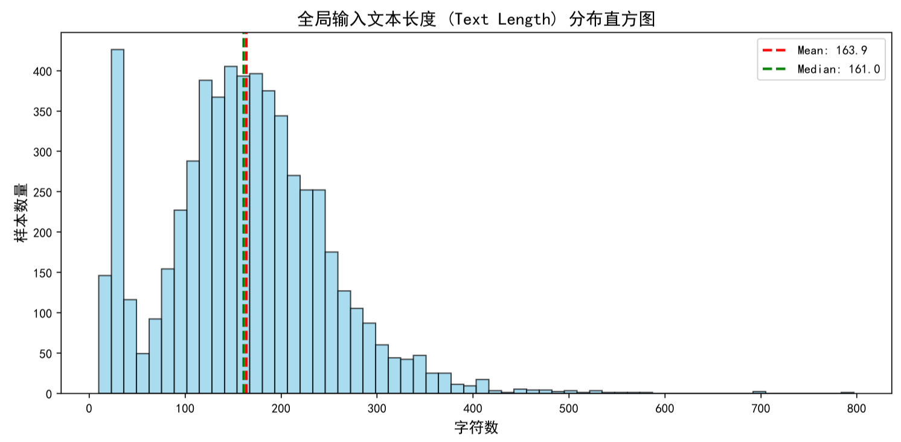
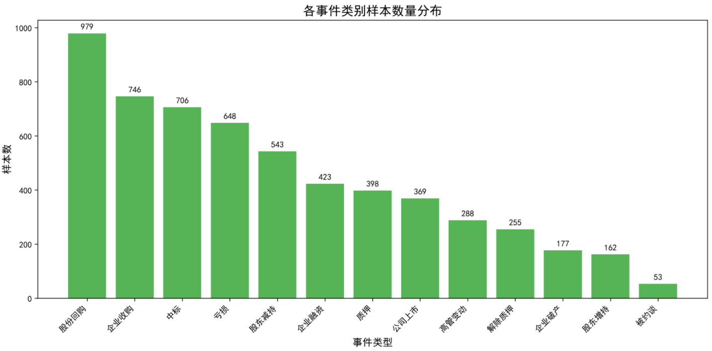
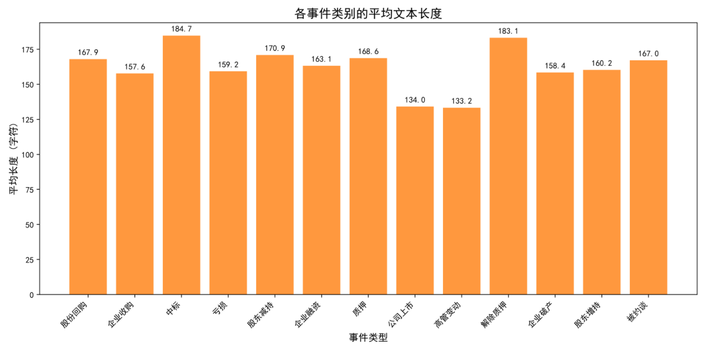
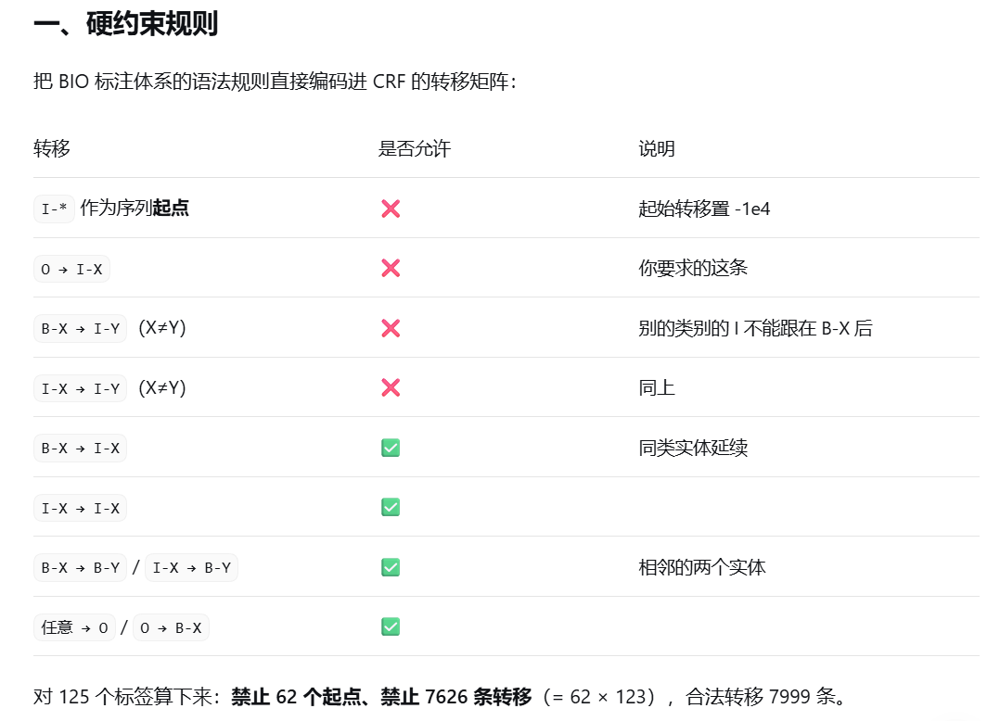

# 结论
我的训练结果是Qwen3-0.6B + LoRA的效果最好（把分类和trigger也当作抽取来做），在llm few shot 和 api few shot 中，给模型所有的角色和分类特别重要，在没有给角色和分类前，api的效果是0.0...给了以后直接变成Argument F1: 0.5567。证明在抽取中角色、分类的完整性和有效数据特别重要，Bert + CRF硬编码反而不如Bert + CRF,说明模型在软规则中已经学会了一些东西。

## 简历
项目：投研工作台 · 信息抽取模块（个人项目 / 2026.11）
背景：投研每天几百条公告，人工摘「谁、什么事件、多少钱、哪天」，一条要 3–5 分钟。
数据探索：13 类事件、92 个「类型×角色」槽位（61 个论元角色）；类别不均衡 18.5×（979 : 53）；
         检测集 77.9% 负样本；句子最长 797 字（P90 265）超出 512 上限
         → 定下「切句 + 长文本滑窗 + 检测单列一级」。
主要工作：
1) 定义事件三层口径（类型 → 触发词 → 论元），构建 125 个 BIO 标签（O + 62 角色 × B/I）；
2) 六路同口径对比：规则词典+正则 / 字符级 BiLSTM-CRF / BERT+Linear / BERT+CRF /
   BERT+CRF+硬约束 / LLM（few-shot 与 LoRA 微调）；
3) 处理子词对齐（word_ids 映射、非首子词 -100）与非法 BIO（CRF 转移硬约束）；
4) 生成式路线：few-shot / LoRA SFT + 实体 offset 回填 + JSON 平衡括号兜底解析；
5) 落地 extract_event()：切句 → 检测（挡掉 77.9% 负样本）→ 抽槽 → 正则兜底 → 校验 → 低置信转人工。
结果（dev 920 条，统一 Trigger / Argument / Event 三项严格匹配 F1）：
· 规则基线 0.270 / 0.001 / 0.000 —— 召回 0.74 但精度仅 0.17，「能判类型、填不出槽位」；
· 判别式：BiLSTM-CRF 0.845 → BERT 0.906 → BERT+CRF 0.915（Trigger）；
  Argument 0.664 → 0.746 → 0.792（CRF +4.7 点）；
· 硬约束 CRF：封禁 62 个 I-* 起点、7,626/15,625 条非法转移（0 训练成本），
  Trigger 0.919、Precision +2.1 点，但净增益仅 +0.4 点 —— 软约束 CRF 已从数据学到大部分合法转移；
· 生成式：Qwen-0.6B few-shot 0.577 / 0.156 / 0.005；DeepSeek few-shot 0.758 / 0.557 / 0.066；
  LoRA 微调 0.946 / 0.826 / 0.432 —— 三项最优，Event F1 比最强判别式 +7.0 点；
· 成本：LoRA 0.55 s/条（本地 GPU，batch=32）vs DeepSeek 3.5 s/条（网络），JSON 解析失败 0/920。

## 一、五个模型的效果对比

> 验证集统一为 `data/processed/dev_extract_clean.jsonl`（920 条），指标口径统一为
> `(实体文本, 起始下标)` 严格匹配，详见文末「指标口径说明」。

| 模型 | Trigger P / R / **F1** | Argument P / R / **F1** | Event P / R / **F1** |
|---|---|---|---|
| BiLSTM + CRF | 0.8827 / 0.8098 / **0.8447** | 0.7238 / 0.6135 / **0.6641** | 0.2026 / 0.1859 / **0.1939** |
| BERT + 线性分类头 | 0.9204 / 0.8924 / **0.9062** | 0.7208 / 0.7720 / **0.7455** | 0.3330 / 0.3228 / **0.3278** |
| BERT + CRF | 0.9236 / 0.9065 / **0.9150** | 0.8012 / 0.7838 / **0.7924** | 0.3654 / 0.3587 / **0.3620** |
| BERT + CRF + 硬约束 | 0.9449 / 0.8946 / **0.9190** | 0.8092 / 0.7740 / **0.7912** | 0.3708 / 0.3511 / **0.3607** |
| **Qwen3-0.6B + LoRA** | **0.9467 / 0.9457 / 0.9462** | **0.8337 / 0.8185 / 0.8260** | **0.4320 / 0.4315 / 0.4318** |

**结论：**

1. **Qwen3-0.6B + LoRA 三项指标全部最优**：Trigger 0.9462、Argument 0.8260、Event 0.4318，
   相比 BERT 系列的最佳成绩（Trigger 0.9190 来自硬约束版，Argument 0.7924 / Event 0.3620
   来自软约束版）分别高出 **+0.027 / +0.034 / +0.070**。
2. **在 BERT 上加 CRF 有稳定收益**：Trigger +0.009、Argument +0.047、Event +0.034，
   主要来自 Precision 的提升（CRF 抑制了碎片化实体与非法 BIO 序列）。
3. **硬约束（把 BIO 语法规则写进 CRF 转移矩阵）边际收益很小**：
   Precision 从 0.9236 升到 0.9449（**+0.021**），但 Recall 从 0.9065 降到 0.8946（**−0.012**），
   净效果 Trigger **+0.004**、Argument −0.001、Event −0.001，基本持平。
   原因是软约束 CRF 已从训练数据中学到了绝大部分合法转移，硬编码只让模型变得更保守
   （宁可少抽，也不越界），并未带来新的信息。
4. **Event F1 的差距最能体现方法差异**（要求 trigger 与全部论元集合完全一致）：
   BiLSTM 0.1939 → BERT 0.3278 → BERT+CRF 0.3620 → **LLM 0.4318**。
   生成式模型一次性输出完整事件结构，比逐 token 独立分类更适合这个指标。
5. **代价是推理速度**：LLM 单条生成 547 ms（batch=32），约为 BERT 的 22 ms 的 25 倍。

## 二、数据集

| 用途 | 文件 | 条数 |
|---|---|---|
| 训练集 | `data/processed/train_extract.jsonl` | 5747 |
| 验证集 | `data/processed/dev_extract_clean.jsonl` | 920 |

- 两个文件结构一致：`id / sent_id / text / event`（event 内含 type、trigger、args 及字符偏移）。
- **无数据泄漏**：train 与 dev 的 `sent_id` 交集为 0，`text` 交集为 0。
- 验证集 920 句对应 920 个事件（单句单事件）；语料共 13 类事件、62 个论元角色，
  展开成 BIO 后为 125 个标签（O + 62 × (B, I)）。
- 五个模型使用**完全相同**的训练/验证文件（BiLSTM 受实现限制跳过了长度 > 512 的 11 条，
  实际使用 5736 条）；逐句预测结果统一输出到
  `output/bilstm_crf/{bilstm,bert,bert_crf,bert_crf_hard,llm_lora}.jsonl`。

## 三、效率对比

硬件：NVIDIA RTX 3080 Laptop GPU（16 GB），PyTorch 2.13 + CUDA 13.2。

**训练耗时**

| 模型 | 训练轮数 | 训练耗时 | 每轮均摊 |
|---|---|---|---|
| BiLSTM + CRF | 15 | ≈ 27 分钟 | ≈ 1.8 分钟 |
| BERT | 9（早停） | ≈ 25 分钟 | ≈ 2.7 分钟 |
| BERT + CRF | 15（跑满） | ≈ 90 分钟 | ≈ 6.0 分钟 |
| BERT + CRF + 硬约束 | 10（早停） | ≈ 54 分钟 | ≈ 5.4 分钟 |
| Qwen3-0.6B + LoRA | 3 | ≈ 70 分钟 | ≈ 23 分钟 |

**验证 / 生成耗时（920 条）**

| 模型 | 端到端耗时 | 折合单条 |
|---|---|---|
| BERT | 20.3 秒 | 22 ms |
| BERT + CRF | 26.4 秒 | 29 ms |
| BERT + CRF + 硬约束 | 25.6 秒 | 28 ms |
| BiLSTM + CRF | 30.2 秒 | 33 ms |
| Qwen3-0.6B + LoRA（batch=8） | ≈ 26 分钟 | 1730 ms |
| **Qwen3-0.6B + LoRA（batch=32）** | **≈ 8.6 分钟** | **547 ms** |

> BERT 系列为端到端墙钟时间（含约 5 秒依赖导入与模型加载）；LLM 的两行为纯生成阶段
> 耗时，由脚本内部计时。同样硬件下，生成 batch 从 8 提到 32 可提速 3.2 倍。

## 四、指标口径说明

- 所有模型统一按 **(实体文本, 起始下标)** 严格匹配；Event 还要求 trigger 与论元集合完全一致。
- LLM 的 `start` 由「实体文本在原文中反查」得到（不让小模型直接生成字符下标）。
  用完美 JSON 回灌测得**理论上限**：Trigger 1.0000 / Argument **0.9746** / Event 1.0000，
  即反查歧义造成的损失已如实计入，不构成虚高。
- 若**完全忽略 start**（只比文本），LLM 仍为 0.9462 / 0.8371 / 0.4318，
  仍高于 BERT + CRF 的 0.9161 / 0.7951 / 0.3631 —— 优势并非来自「少算 start/end」。

## 五、Few-Shot 对比（200 条子集）

> 下面三个实验只跑了 `dev_extract_clean.jsonl` 的**前 200 条**，
> **不能与第一节的 920 条结果直接比较**，只能在这三行之间横向对比。

| 模型（同一批 200 条 / 同一 prompt / 同一指标） | Trigger F1 | Argument F1 | Event F1 |
|---|---|---|---|
| Qwen3-0.6B（Few-Shot，未训练） | 0.5765 | 0.1560 | 0.0051 |
| DeepSeek（Few-Shot，未训练） | 0.7576 | 0.5567 | 0.0657 |
| Qwen3-0.6B（LoRA 微调，同 200 条） | **0.9500** | **0.8339** | **0.4350** |

**结论：**

1. **模型规模确实有效，但远远不够**：DeepSeek 仅靠 few-shot 就把 Qwen3-0.6B 的
   Trigger 从 0.58 拉到 0.76、Argument 从 0.16 拉到 0.56（**+0.40**）。论元差距最大，
   说明大模型对「角色名要贴合固定 schema」这件事理解得明显更好。
2. **但微调过的 0.6B 仍然全面反超 DeepSeek few-shot**：Trigger **+0.19**、
   Argument **+0.28**、Event **+0.37**。一个 0.6B 的小模型，只要在 5747 条带标注数据上
   做过 LoRA 微调，就打赢了参数量大两个数量级、且带 schema 提示的 DeepSeek。
3. **根因是「固定 schema」**：本任务的论元角色是 61 个固定名称，3 个 few-shot 示例
   最多覆盖 3 类事件里的十几个角色，其余只能靠猜；微调把这套角色名直接写进了权重，
   所以论元的提升幅度最大。
4. **Event F1 最能体现这一差距**：它要求 trigger 与全部论元集合完全一致，
   Few-Shot 即使换成大模型也只有 0.066，微调后达到 **0.435**。
5. **工程成本也是反向的**：DeepSeek 每条 **3547 ms**（走网络、有 1/200 解析失败），
   微调后的 Qwen-0.6B 每条 **547 ms**（本地 GPU、JSON 解析零失败），又快又准。

> 附：旧版 few-shot 数字（Qwen 0.1768 / DeepSeek 0.1696）已作废——
> 旧版把评估跑在检测集上（约 80% 无标注）、且 FN 重复计数，既不可信也不可比。

# 数据特征
(base) PS D:\deeplearning> & D:/Users/52963/anaconda3/python.exe d:/deeplearning/week7/week7-信息抽取/week7-信息抽取/homework/data/scripts/analyze_data.py
正在读取并分析: d:\deeplearning\week7\week7-信息抽取\week7-信息抽取\homework\data\processed\train_extract.jsonl ...

============================================================
📊 全局输入文本 (text) 特征统计
============================================================
总样本数     : 5747
平均长度     : 163.87 字符
中位数长度   : 161 字符
最短 / 最长  : 10 / 797 字符
P90 / P99    : 265 / 392 字符

============================================================
📊 事件类型 (Event Type) 统计 (共 13 种)
============================================================
🔹 类别: 【股份回购】 | 数量: 979 (17.03%) | 平均长度: 167.9
   - 触发词 (Triggers): 回购, 股票回购, 购入, 购回
   - 论元角色 (Roles) : 交易金额, 占公司总股本比例, 回购完成时间, 回购方, 回购股份数量, 披露时间, 每股交易价格
   - 全量角色数 : 7 个
   - 包含所有角色的样本 : 148 个 (占比: 15.12%)
🔹 类别: 【企业收购】 | 数量: 746 (12.98%) | 平均长度: 157.6
   - 触发词 (Triggers): 出售, 出让, 取得, 受让, 合并, 并购, 投资, 拿下, 收購, 收购, 认购, 购买, 购入, 转让, 重组
   - 论元角色 (Roles) : 交易金额, 披露时间, 收购完成时间, 收购方, 收购标的, 被收购方
   - 全量角色数 : 6 个
   - 包含所有角色的样本 : 16 个 (占比: 2.14%)
🔹 类别: 【中标】 | 数量: 706 (12.28%) | 平均长度: 184.7
   - 触发词 (Triggers): 中标, 承建, 招标, 连中三标
   - 论元角色 (Roles) : 中标公司, 中标日期, 中标标的, 中标金额, 披露日期, 招标方
   - 全量角色数 : 6 个
   - 包含所有角色的样本 : 88 个 (占比: 12.46%)
🔹 类别: 【亏损】 | 数量: 648 (11.28%) | 平均长度: 159.2
   - 触发词 (Triggers): 下跌, 亏, 亏损, 亏蚀, 亿航智能, 净亏损, 巨亏, 损失, 损至
   - 论元角色 (Roles) : 亏损变化, 公司名称, 净亏损, 披露时间, 财报周期
   - 全量角色数 : 5 个
   - 包含所有角色的样本 : 188 个 (占比: 29.01%)
🔹 类别: 【股东减持】 | 数量: 543 (9.45%) | 平均长度: 170.9
   - 触发词 (Triggers): 减少, 减持, 卖出, 持股量减少
   - 论元角色 (Roles) : 交易完成时间, 交易股票/股份数量, 交易金额, 减持方, 减持部分占总股本比例, 减持部分占所持比例, 披露时间, 每股交易价格, 股票简称
   - 全量角色数 : 9 个
   - 包含所有角色的样本 : 0 个 (占比: 0.00%)
🔹 类别: 【企业融资】 | 数量: 423 (7.36%) | 平均长度: 163.1
   - 触发词 (Triggers): 募资, 募集, 募集资金, 发行, 发行债券, 增发, 扶持, 投资, 挂牌上市, 融资, 融资券, 补助, 集资, 非公开发行, 非公开发行股票
   - 论元角色 (Roles) : 事件时间, 投资方, 披露时间, 融资轮次, 融资金额, 被投资方, 领投方
   - 全量角色数 : 7 个
   - 包含所有角色的样本 : 4 个 (占比: 0.95%)
🔹 类别: 【质押】 | 数量: 398 (6.93%) | 平均长度: 168.6
   - 触发词 (Triggers): 出质, 延期, 质押
   - 论元角色 (Roles) : 事件时间, 披露时间, 质押方, 质押物, 质押物占总股比, 质押物占持股比, 质押物所属公司, 质押股票/股份数量, 质权方
   - 全量角色数 : 9 个
   - 包含所有角色的样本 : 1 个 (占比: 0.25%)
🔹 类别: 【公司上市】 | 数量: 369 (6.42%) | 平均长度: 134.0
   - 触发词 (Triggers): IPO, 上会, 上市, 发行, 发行股票, 招股书, 挂牌, 摘牌, 登陆, 终止上市, 退市, 闯关, 首次公开募股
   - 论元角色 (Roles) : 上市公司, 事件时间, 募资金额, 发行价格, 市值, 披露时间, 环节, 证券代码
   - 全量角色数 : 8 个
   - 包含所有角色的样本 : 0 个 (占比: 0.00%)
🔹 类别: 【高管变动】 | 数量: 288 (5.01%) | 平均长度: 133.2
   - 触发词 (Triggers): 上任, 不再担任, 任, 任命, 任职, 免去, 入职, 兼任, 出任, 加盟, 升任, 卸任, 去世, 变更, 增聘, 大换血, 委任, 将任, 就任, 履行, 担任, 招来, 接任, 接替, 接棒, 提名, 新任, 新添, 离职, 聘, 聘任, 聘请, 调任, 辞任, 辞去, 辞职, 退任, 退休, 退出, 选举, 逝世
   - 论元角色 (Roles) : 事件时间, 任职公司, 变动后公司名称, 变动后职位, 变动类型, 披露日期, 高管姓名, 高管职位
   - 全量角色数 : 8 个
   - 包含所有角色的样本 : 2 个 (占比: 0.69%)
🔹 类别: 【解除质押】 | 数量: 255 (4.44%) | 平均长度: 183.1
   - 触发词 (Triggers): 到期, 延期, 延期购回, 解押, 解质, 解质押, 解除, 解除了质押, 解除质押, 质押, 质押式回购, 质押解除
   - 论元角色 (Roles) : 事件时间, 披露时间, 质押方, 质押物, 质押物占总股比, 质押物占持股比, 质押物所属公司, 质押股票/股份数量, 质权方
   - 全量角色数 : 9 个
   - 包含所有角色的样本 : 2 个 (占比: 0.78%)
🔹 类别: 【企业破产】 | 数量: 177 (3.08%) | 平均长度: 158.4
   - 触发词 (Triggers): 倒闭, 破产, 破产重组
   - 论元角色 (Roles) : 债务规模, 债权人, 披露时间, 破产公司, 破产时间
   - 全量角色数 : 5 个
   - 包含所有角色的样本 : 2 个 (占比: 1.13%)
🔹 类别: 【股东增持】 | 数量: 162 (2.82%) | 平均长度: 160.2
   - 触发词 (Triggers): 买入, 增加, 增持, 增资, 持股量增加, 购买
   - 论元角色 (Roles) : 交易完成时间, 交易股票/股份数量, 交易金额, 增持方, 增持部分占总股本比例, 增持部分占所持比例, 披露时间, 每股交易价格, 股票简称
   - 全量角色数 : 9 个
   - 包含所有角色的样本 : 0 个 (占比: 0.00%)
🔹 类别: 【被约谈】 | 数量: 53 (0.92%) | 平均长度: 167.0
   - 触发词 (Triggers): 约谈, 被约谈, 谈话
   - 论元角色 (Roles) : 公司名称, 披露时间, 约谈机构, 被约谈时间
   - 全量角色数 : 4 个
   - 包含所有角色的样本 : 11 个 (占比: 20.75%)

✅ 3 张图片已生成并保存至 processed 目录：
   1. text_length_distribution.png (全局长度直方图)
   
   2. type_counts_distribution.png (类别样本数柱状图)
   
   3. type_avg_length_distribution.png (类别平均长度柱状图)
   

✅ 详细的事件 Schema 与特征统计已导出至: d:\deeplearning\week7\week7-信息抽取\week7-信息抽取\homework\data\processed\event_schema_analysis.xlsx

# 规则
规则提取：读取 train_extract.jsonl 建立类别库（包含每个类的触发词和论元）。

类别判定：遍历文本，看包含哪些类别的触发词，哪个类别的触发词出现了最多次，就判为哪个类别。

Trigger 匹配：根据你要求的，trigger.text 优先设置为类别名本身，并获取其位置 start/end。如果文本中没有这个类别名，就回退匹配使用的触发词。

Args 提取：在文本中寻找对应的 role（如“质押方”），一旦找到，从该角色词的下一个字开始，截取5个字作为论元内容，并记录正确的 start/end。

(base) PS D:\deeplearning> & D:/Users/52963/anaconda3/python.exe d:/deeplearning/week7/week7-信息抽取/week7-信息抽取/homework/rule/rule.py
1. 正在读取训练集提取规则...
2. 正在读取验证集真实标签...
3. 正在应用规则预测并计算指标...

==================================================
✅ 规则抽取完成！全局指标如下：
 - Trigger F1 : 0.2698 (P: 0.1651, R: 0.7375)
 - Argument F1: 0.0005 (P: 0.0034, R: 0.0003)
 - Event F1   : 0.0000 (P: 0.0000, R: 0.0000)

📁 详细预测结果及指标已保存至: d:\deeplearning\week7\week7-信息抽取\week7-信息抽取\homework\output\rule.jsonl
==================================================

# BiLstm + crf
(base) PS D:\deeplearning> & D:/Users/52963/anaconda3/python.exe d:/deeplearning/week7/week7-信息抽取/week7-信息抽取/homework/biLSTM/bilstm_train.py
1. 正在构建字典与数据集...
   数据量: 5736 条, 标签类别数: 125
2. 初始化 BiLSTM+CRF 模型...
3. 开始训练...
Epoch 1/15: 100%|█████████████████████████████████████████████████████████████████████████████████████████████████████████| 180/180 [01:51<00:00,  1.61it/s, loss=144.8923]
Epoch 2/15: 100%|██████████████████████████████████████████████████████████████████████████████████████████████████████████| 180/180 [01:51<00:00,  1.61it/s, loss=98.4479]
Epoch 3/15: 100%|██████████████████████████████████████████████████████████████████████████████████████████████████████████| 180/180 [01:49<00:00,  1.64it/s, loss=68.3294]
Epoch 4/15: 100%|██████████████████████████████████████████████████████████████████████████████████████████████████████████| 180/180 [01:45<00:00,  1.71it/s, loss=47.7999]
Epoch 5/15: 100%|██████████████████████████████████████████████████████████████████████████████████████████████████████████| 180/180 [01:44<00:00,  1.73it/s, loss=46.4363]
Epoch 6/15: 100%|██████████████████████████████████████████████████████████████████████████████████████████████████████████| 180/180 [01:44<00:00,  1.72it/s, loss=27.6570]
Epoch 7/15: 100%|██████████████████████████████████████████████████████████████████████████████████████████████████████████| 180/180 [01:48<00:00,  1.65it/s, loss=19.6684]
Epoch 8/15: 100%|██████████████████████████████████████████████████████████████████████████████████████████████████████████| 180/180 [01:42<00:00,  1.75it/s, loss=27.3015]
Epoch 9/15: 100%|██████████████████████████████████████████████████████████████████████████████████████████████████████████| 180/180 [01:48<00:00,  1.66it/s, loss=14.7626]
Epoch 10/15: 100%|█████████████████████████████████████████████████████████████████████████████████████████████████████████| 180/180 [01:45<00:00,  1.71it/s, loss=10.7199]
Epoch 11/15: 100%|█████████████████████████████████████████████████████████████████████████████████████████████████████████| 180/180 [01:45<00:00,  1.70it/s, loss=18.8553]
Epoch 12/15: 100%|█████████████████████████████████████████████████████████████████████████████████████████████████████████| 180/180 [01:44<00:00,  1.72it/s, loss=12.6469]
Epoch 13/15: 100%|██████████████████████████████████████████████████████████████████████████████████████████████████████████| 180/180 [01:44<00:00,  1.72it/s, loss=8.3110]
Epoch 14/15: 100%|██████████████████████████████████████████████████████████████████████████████████████████████████████████| 180/180 [01:43<00:00,  1.74it/s, loss=8.4131]
Epoch 15/15: 100%|█████████████████████████████████████████████████████████████████████████████████████████████████████████| 180/180 [01:44<00:00,  1.73it/s, loss=10.1899]
✅ 模型已保存至: d:\deeplearning\week7\week7-信息抽取\week7-信息抽取\homework\output\bilstm_crf/bilstm_crf_model.pt
(base) PS D:\deeplearning> & D:/Users/52963/anaconda3/python.exe d:/deeplearning/week7/week7-信息抽取/week7-信息抽取/homework/biLSTM/bilstm_valid.py
1. 加载模型与字典...
2. 加载验证集数据...
3. 开始推理与计算指标...
当前使用的设备是: cuda

==================================================
✅ BiLSTM+CRF 验证完成！全局指标如下：
 - Trigger F1 : 0.8447 (P: 0.8827, R: 0.8098)
 - Argument F1: 0.6641 (P: 0.7238, R: 0.6135)
 - Event F1   : 0.1939 (P: 0.2026, R: 0.1859)

📁 详细结果已保存至: d:\deeplearning\week7\week7-信息抽取\week7-信息抽取\homework\output\bilstm_crf\bilstm.jsonl
{"global_metrics": {"Trigger": {"Precision": 0.8827, "Recall": 0.8098, "F1": 0.8447}, "Argument": {"Precision": 0.7238, "Recall": 0.6135, "F1": 0.6641}, "Event": {"Precision": 0.2026, "Recall": 0.1859, "F1": 0.1939}}}

# Bert
(base) PS D:\deeplearning> & D:/Users/52963/anaconda3/python.exe d:/deeplearning/week7/week7-信息抽取/week7-信息抽取/homework/bert/bert_ori_train.py
✅ 当前使用的设备: cuda
1. 初始化字典与数据集...
2. 加载预训练模型...
Some weights of BertForTokenClassification were not initialized from the model checkpoint at d:\deeplearning\week7\week7-信息抽取\week7-信息抽取\homework\bert\bert-base-chinese and are newly initialized: ['classifier.bias', 'classifier.weight']
You should probably TRAIN this model on a down-stream task to be able to use it for predictions and inference.
3. 开始训练...
Epoch 1/10: 100%|███████████████████████████████████████████████████████████████████████████████████████████████████████████| 360/360 [04:09<00:00,  1.44it/s, loss=0.1835]
 [Epoch 1] 平均训练 Loss: 0.2217
 🌟 发现更低 Loss (0.2217)，保存模型...
Epoch 2/10: 100%|███████████████████████████████████████████████████████████████████████████████████████████████████████████| 360/360 [04:15<00:00,  1.41it/s, loss=0.0251]
 [Epoch 2] 平均训练 Loss: 0.0672
 🌟 发现更低 Loss (0.0672)，保存模型...
Epoch 3/10: 100%|███████████████████████████████████████████████████████████████████████████████████████████████████████████| 360/360 [04:15<00:00,  1.41it/s, loss=0.0640]
 [Epoch 3] 平均训练 Loss: 0.0443
 🌟 发现更低 Loss (0.0443)，保存模型...
Epoch 4/10: 100%|███████████████████████████████████████████████████████████████████████████████████████████████████████████| 360/360 [04:16<00:00,  1.41it/s, loss=0.0324]
 [Epoch 4] 平均训练 Loss: 0.0338
 🌟 发现更低 Loss (0.0338)，保存模型...
Epoch 5/10: 100%|███████████████████████████████████████████████████████████████████████████████████████████████████████████| 360/360 [04:16<00:00,  1.40it/s, loss=0.0269]
 [Epoch 5] 平均训练 Loss: 0.0273
 🌟 发现更低 Loss (0.0273)，保存模型...
Epoch 6/10: 100%|███████████████████████████████████████████████████████████████████████████████████████████████████████████| 360/360 [04:16<00:00,  1.40it/s, loss=0.0190]
 [Epoch 6] 平均训练 Loss: 0.0220
 🌟 发现更低 Loss (0.0220)，保存模型...
Epoch 7/10: 100%|███████████████████████████████████████████████████████████████████████████████████████████████████████████| 360/360 [04:17<00:00,  1.40it/s, loss=0.0194]
 [Epoch 7] 平均训练 Loss: 0.0182
 🌟 发现更低 Loss (0.0182)，保存模型...
Epoch 8/10: 100%|███████████████████████████████████████████████████████████████████████████████████████████████████████████| 360/360 [04:17<00:00,  1.40it/s, loss=0.0121]
 [Epoch 8] 平均训练 Loss: 0.0146
 🌟 发现更低 Loss (0.0146)，保存模型...
Epoch 9/10: 100%|███████████████████████████████████████████████████████████████████████████████████████████████████████████| 360/360 [04:17<00:00,  1.40it/s, loss=0.0285]
 [Epoch 9] 平均训练 Loss: 0.0126
 🌟 发现更低 Loss (0.0126)，保存模型...
Epoch 10/10: 100%|██████████████████████████████████████████████████████████████████████████████████████████████████████████| 360/360 [04:17<00:00,  1.40it/s, loss=0.0059]
 [Epoch 10] 平均训练 Loss: 0.0104
 🌟 发现更低 Loss (0.0104)，保存模型...

(base) PS D:\deeplearning> & D:/Users/52963/anaconda3/python.exe d:/deeplearning/week7/week7-信息抽取/week7-信息抽取/homework/biLSTM/bilstm_valid.py
1. 加载模型与字典...
2. 加载验证集数据...
3. 开始推理与计算指标...
当前使用的设备是: cuda

==================================================
✅ Bert 验证完成！全局指标如下：
 - Trigger F1 : 0.9062 (P: 0.9204, R: 0.8924)
 - Argument F1: 0.7455 (P: 0.7208, R: 0.772)
 - Event F1   : 0.3278 (P: 0.333, R: 0.3228)

📁 详细结果已保存至: d:\deeplearning\week7\week7-信息抽取\week7-信息抽取\homework\output\bilstm_crf\bilstm.jsonl

# Bert + crf
==================================================
✅ Bert+CRF 验证完成！全局指标如下：
 - Trigger F1 : 0.915 (P: 0.9236, R: 0.9065)
 - Argument F1: 0.7924 (P: 0.8012, R: 0.7838)
 - Event F1   : 0.362 (P: 0.3654, R: 0.3587)
{"global_metrics": {"Trigger": {"Precision": 0.9236, "Recall": 0.9065, "F1": 0.915}, "Argument": {"Precision": 0.8012, "Recall": 0.7838, "F1": 0.7924}, "Event": {"Precision": 0.3654, "Recall": 0.3587, "F1": 0.362}}}

# Bert + crf + 硬约束
硬约束规则（比课上多了两条）：

(base) PS D:\deeplearning> python "D:\deeplearning\week7\week7-信息抽取\week7-信息抽取\homework\bert\bert_crf_hard_train.py"
✅ 当前使用的设备: cuda
1. 初始化字典与数据集...
   标签数: 125  (O + B/I × 62 个角色)
   硬约束: 禁止 62 个 I-* 作为起点；禁止 7626/15625 条非法转移
   （合法的起始标签 63 个，合法转移 7999 条）
   训练样本数: 5747
   验证样本数: 920
2. 加载预训练 BERT 并接上「硬约束 CRF」...
   BERT 参数: 102.3M | 分类头+CRF 参数: 0.112M
   约束初始化检查: ✅ 通过
3. 开始训练...
Epoch 1/15: 100%|███████████████████████████████████████████████████████████████████████████████████████████████████████████| 360/360 [05:25<00:00,  1.11it/s, loss=0.0746]
 [Epoch 1] 训练Loss: 1.0794 | Dev Trigger  P=0.9001 R=0.8815 F1=0.8907  (tp=811 fp=90 fn=109)
 🌟 Dev F1 提升到 0.8907，保存模型...
Epoch 2/15: 100%|███████████████████████████████████████████████████████████████████████████████████████████████████████████| 360/360 [05:12<00:00,  1.15it/s, loss=0.0861]
 [Epoch 2] 训练Loss: 0.9739 | Dev Trigger  P=0.9132 R=0.8924 F1=0.9027  (tp=821 fp=78 fn=99)
 🌟 Dev F1 提升到 0.9027，保存模型...
Epoch 3/15: 100%|███████████████████████████████████████████████████████████████████████████████████████████████████████████| 360/360 [05:18<00:00,  1.13it/s, loss=0.0261]
 [Epoch 3] 训练Loss: 0.9504 | Dev Trigger  P=0.8957 R=0.9152 F1=0.9054  (tp=842 fp=98 fn=78)
 🌟 Dev F1 提升到 0.9054，保存模型...
Epoch 4/15: 100%|███████████████████████████████████████████████████████████████████████████████████████████████████████████| 360/360 [05:18<00:00,  1.13it/s, loss=0.0049]
 [Epoch 4] 训练Loss: 0.9351 | Dev Trigger  P=0.9296 R=0.8902 F1=0.9095  (tp=819 fp=62 fn=101)
 🌟 Dev F1 提升到 0.9095，保存模型...
Epoch 5/15: 100%|███████████████████████████████████████████████████████████████████████████████████████████████████████████| 360/360 [05:28<00:00,  1.10it/s, loss=0.0068]
 [Epoch 5] 训练Loss: 0.9638 | Dev Trigger  P=0.9143 R=0.9043 F1=0.9093  (tp=832 fp=78 fn=88)
 Dev F1 未提升（已 1/4 轮）
Epoch 6/15: 100%|███████████████████████████████████████████████████████████████████████████████████████████████████████████| 360/360 [05:22<00:00,  1.11it/s, loss=0.0043]
 [Epoch 6] 训练Loss: 0.9482 | Dev Trigger  P=0.9449 R=0.8946 F1=0.9190  (tp=823 fp=48 fn=97)
 🌟 Dev F1 提升到 0.9190，保存模型...
Epoch 7/15: 100%|███████████████████████████████████████████████████████████████████████████████████████████████████████████| 360/360 [05:19<00:00,  1.13it/s, loss=0.0109]
 [Epoch 7] 训练Loss: 0.9237 | Dev Trigger  P=0.9263 R=0.9011 F1=0.9135  (tp=829 fp=66 fn=91)
 Dev F1 未提升（已 1/4 轮）
Epoch 8/15: 100%|███████████████████████████████████████████████████████████████████████████████████████████████████████████| 360/360 [05:22<00:00,  1.12it/s, loss=0.0292]
 [Epoch 8] 训练Loss: 0.9288 | Dev Trigger  P=0.9078 R=0.8989 F1=0.9033  (tp=827 fp=84 fn=93)
 Dev F1 未提升（已 2/4 轮）
Epoch 9/15: 100%|███████████████████████████████████████████████████████████████████████████████████████████████████████████| 360/360 [05:26<00:00,  1.10it/s, loss=0.0040]
 [Epoch 9] 训练Loss: 0.9082 | Dev Trigger  P=0.9012 R=0.9217 F1=0.9113  (tp=848 fp=93 fn=72)
 Dev F1 未提升（已 3/4 轮）
Epoch 10/15: 100%|██████████████████████████████████████████████████████████████████████████████████████████████████████████| 360/360 [05:24<00:00,  1.11it/s, loss=0.0047]
 [Epoch 10] 训练Loss: 0.9207 | Dev Trigger  P=0.9344 R=0.8978 F1=0.9157  (tp=826 fp=58 fn=94)
 Dev F1 未提升（已 4/4 轮）
 ⏹ 早停：连续 4 轮没有提升。
✅ 训练完成！最优模型已保存至 D:\deeplearning\week7\week7-信息抽取\week7-信息抽取\homework\output\bert_crf_hard  (best Dev Trigger F1 = 0.9190)
   约束最终检查: ✅ 仍然全部生效

(base) PS D:\deeplearning> python "D:\deeplearning\week7\week7-信息抽取\week7-信息抽取\homework\bert\bert_crf_hard_valid.py"
✅ 当前使用的设备: cuda
1. 加载模型与字典...
   标签数: 125，模型参数: 102.4M
   硬约束: 禁止 62 个 I-* 起点；禁止 7626/15625 条非法转移
   约束检查: ✅ 已生效
2. 加载验证集...
   句子数: 920 | 含事件句子: 920 | GT事件: 920 | GT论元: 4093
3. 开始推理与计算指标...

---- 预测示例 ----
[1] 据腾讯美股30日消息，据知情人士透露，理想汽车告诉潜在投资者，计划把美国首次公开募股（IPO）发行价
    GT  : 'IPO' args=[('上市公司', '理想汽车'), ('披露时间', '30日'), ('发行价格', '8-10美元')]
    PRED: <无>
[2] 翔鹭钨业：股东众达投资854.68万股股份解除质押
    GT  : '解除质押' args=[('质押物所属公司', '翔鹭钨业'), ('质押方', '众达投资'), ('质押股票/股份数量', '854.68万'), ('质押物', '股份')]
    PRED: '解除质押' args=[('质押物所属公司', '翔鹭钨业'), ('质押方', '众达'), ('质押股票/股份数量', '854.68万'), ('质押物', '股份')]

==================================================
✅ BERT+CRF+硬约束 验证完成！全局指标如下：
 - Trigger F1 : 0.9190 (P: 0.9449, R: 0.8946)
 - Argument F1: 0.7912 (P: 0.8092, R: 0.7740)
 - Event F1   : 0.3607 (P: 0.3708, R: 0.3511)

📁 详细结果已保存至: D:\deeplearning\week7\week7-信息抽取\week7-信息抽取\homework\output\bilstm_crf\bert_crf_hard.jsonl
==================================================

# Qianwen3.06B + Lora
 [Epoch 3] 训练Loss: 0.0446 | Dev子集 Trigger  P=0.9417 R=0.9417 F1=0.9417 | 峰值显存 8.5GB
✅ 训练完成！LoRA adapter 已保存至 D:\deeplearning\week7\week7-信息抽取\week7-信息抽取\homework\output\llm_lora
   最优 Dev 子集 Trigger F1 = 0.9417

(base) PS D:\deeplearning> python "D:\deeplearning\week7\week7-信息抽取\week7-信息抽取\homework\llm_lora\llm_lora_valid.py"
✅ 当前使用的设备: cuda
1. 加载模型与 LoRA adapter...
   已读取 prompt_config.json
   system prompt: 请你作为一个语言提取助手，帮我提取下面语句中的信息。
   模型参数: 606.1M
2. 加载验证集...
   句子数: 920 | 含事件句子: 920 | GT事件: 920 | GT论元: 4093
3. 开始生成与计算指标...
You're using a Qwen2TokenizerFast tokenizer. Please note that with a fast tokenizer, using the `__call__` method is faster than using a method to encode the text followed by a call to the `pad` method to get a padded encoding.

---- 预测示例 ----
[1] 据腾讯美股30日消息，据知情人士透露，理想汽车告诉潜在投资者，计划把美国首次公开募股（IPO）发行价
    GT  : 'IPO' args=[('上市公司', '理想汽车'), ('披露时间', '30日'), ('发行价格', '8-10美元')]
    PRED: 'IPO' args=[('上市公司', '理想汽车'), ('证券代码', '30')]
[2] 翔鹭钨业：股东众达投资854.68万股股份解除质押
    GT  : '解除质押' args=[('质押物所属公司', '翔鹭钨业'), ('质押方', '众达投资'), ('质押股票/股份数量', '854.68万'), ('质押物', '股份')]
    PRED: '解除质押' args=[('质押物所属公司', '翔鹭钨业'), ('质押方', '众达投资'), ('质押股票/股份数量', '854.68万'), ('质押物', '股份')]

==================================================
✅ LLM+LoRA 验证完成！全局指标如下：
 - Trigger F1 : 0.9462 (P: 0.9467, R: 0.9457)
 - Argument F1: 0.8260 (P: 0.8337, R: 0.8185)
 - Event F1   : 0.4318 (P: 0.4320, R: 0.4315)
 - JSON 解析失败: 1/920

📁 详细结果已保存至: D:\deeplearning\week7\week7-信息抽取\week7-信息抽取\homework\output\bilstm_crf\llm_lora.jsonl
==================================================

# Qianwen3.06B zero shot
(base) PS D:\deeplearning\week7\week7-信息抽取\week7-信息抽取\homework> & D:/Users/52963/anaconda3/python.exe d:/deeplearning/week7/week7-信息抽取/week7-信息抽取/homework/llm_lora/llm_zero_shot.py
✅ 当前使用的设备: cuda
1. 加载模型与数据...
   验证集样本数(截断后): 1000
2. 开始 Zero-Shot 推理...
推理进度:   0%|                                                                                                                                     | 0/32 [00:00<?, ?it/s]You're using a Qwen2TokenizerFast tokenizer. Please note that with a fast tokenizer, using the `__call__` method is faster than using a method to encode the text followed by a call to the `pad` method to get a padded encoding.
推理进度: 100%|████████████████████████████████████████████████████████████████████████████████████████████████████████████████████████████| 32/32 [09:39<00:00, 18.10s/it]
3. 解析结果并计算指标...

==================================================
✅ Zero-Shot 验证完成！全局指标如下：
 - Trigger F1 : 0.0546 (P: 0.0455, R: 0.0683)
 - Argument F1: 0.0021 (P: 0.0080, R: 0.0012)
 - Event F1   : 0.0000 (P: 0.0000, R: 0.0000)

📁 详细结果已保存至: d:\deeplearning\week7\week7-信息抽取\week7-信息抽取\homework\output\bilstm_crf\llm_zero_shot.jsonl
==================================================

# Qianwen3.06B few shot

**统一口径重跑结果（200 条，2026-11-26）**

评估集从 `dev_detect_clean.jsonl` 前 1000 行改为 `dev_extract_clean.jsonl` **前 200 条**
（全部带标注）；指标改为 `(text, start)` 严格匹配、`fn = gt − tp`；prompt 中加入
`event_schema.json` 的「事件类型 → 论元角色」映射；贪心解码。

| 指标 | Precision | Recall | F1 |
|---|---|---|---|
| Trigger | 0.5885 | 0.5650 | **0.5765** |
| Argument | 0.1913 | 0.1316 | **0.1560** |
| Event | 0.0052 | 0.0050 | **0.0051** |

- 样本：200 条（全部含事件），JSON 解析失败 **0/200**
- 耗时：3.0 分钟，**893 ms/条**（batch=8，prompt 平均 1452 token）
- few-shot 示例：公司上市 / 股东减持 / 中标（`random.Random(42)` 固定，与 DeepSeek 版完全一致）
- 运行命令：`python llm_few_shot.py --n 200 --batch 8`

> ⚠ **以下为旧版记录，数字已作废**：旧版跑的是检测集前 1000 行（含约 80% 无标注负样本），
> 且 `fn` 把已命中的句子也计入 FN，导致 Recall 上限 0.5、F1 上限 0.667。
> 旧结果（Trigger 0.1768 / Argument 0.0543 / Event 0.0018）不可与任何其它模型比较。

(base) PS D:\deeplearning\week7\week7-信息抽取\week7-信息抽取\homework> & D:/Users/52963/anaconda3/python.exe d:/deeplearning/week7/week7-信息抽取/week7-信息抽取/homework/llm_lora/llm_few_shot.py
✅ 当前使用的设备: cuda
1. 加载模型与数据...
   正在抽取 Few-shot 示例...
   验证集样本数(截断后): 1000
2. 开始 Few-Shot 推理...
推理进度:   0%|                                                                                                                                     | 0/32 [00:00<?, ?it/s]You're using a Qwen2TokenizerFast tokenizer. Please note that with a fast tokenizer, using the `__call__` method is faster than using a method to encode the text followed by a call to the `pad` method to get a padded encoding.
推理进度: 100%|████████████████████████████████████████████████████████████████████████████████████████████████████████████████████████████| 32/32 [07:33<00:00, 14.17s/it]
3. 解析结果并计算指标...

==================================================
✅ Few-Shot 验证完成！全局指标如下：
 - Trigger F1 : 0.1768 (P: 0.1170, R: 0.3612)
 - Argument F1: 0.0543 (P: 0.0391, R: 0.0887)
 - Event F1   : 0.0018 (P: 0.0011, R: 0.0052)

📁 详细结果已保存至: d:\deeplearning\week7\week7-信息抽取\week7-信息抽取\homework\output\bilstm_crf\llm_few_shot.jsonl
==================================================

# deepseek few shot

**脚本已改为与 Qwen 完全相同的口径**（同一评估集、同一 prompt、同一指标）：

1. 评估集 → `dev_extract_clean.jsonl` 前 200 条（旧版用的是检测集前 200 行）
2. 指标 → `(text, start)` 严格匹配，`fn = gt − tp`（旧版 FN 重复计数）
3. 解码 → 显式 `temperature=0`（旧版未设，DeepSeek API 默认 1.0 采样，每次结果都不一样）
4. prompt → 加入「事件类型 → 论元角色」映射（旧版没有角色清单，角色名全靠猜）

(base) PS D:\deeplearning\week7\week7-信息抽取\week7-信息抽取\homework> & D:/Users/52963/anaconda3/python.exe d:/deeplearning/week7/week7-信息抽取/week7-信息抽取/homework/api_shot/api_few_shot.py
1. 准备 few-shot 示例...
   已选 3 个示例，事件类型: ['公司上市', '股东减持', '中标']
2. 读取验证集前 200 条（dev_extract_clean.jsonl）...
   句子数: 200 | 含事件: 200
3. 调用 API（model=deepseek-flash, temperature=0）...
API 预测: 100%|██████████████████████████████████████████████████████████████████████████████████████████████████████████████████████████| 200/200 [11:49<00:00,  3.55s/it]

==================================================
✅ API Few-Shot 验证完成！
 - Trigger F1 : 0.7576 (P: 0.7653, R: 0.7500)
 - Argument F1: 0.5567 (P: 0.5523, R: 0.5612)
 - Event F1   : 0.0657 (P: 0.0663, R: 0.0650)
 - JSON 解析失败: 1/200
 - 耗时: 11.8 分钟（3547 ms/条）

📁 已保存至: D:\deeplearning\week7\week7-信息抽取\week7-信息抽取\homework\output\bilstm_crf\api_few_shot.jsonl
==================================================
